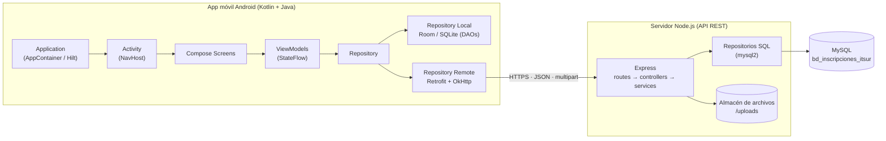
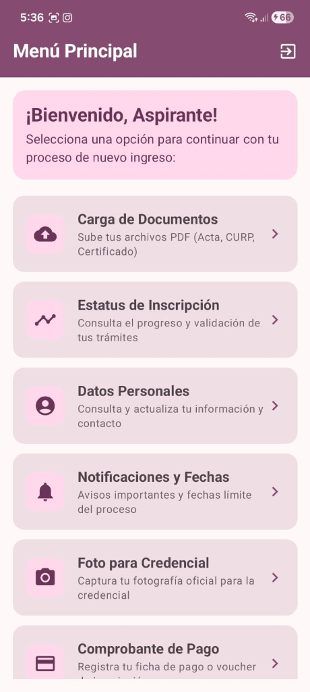
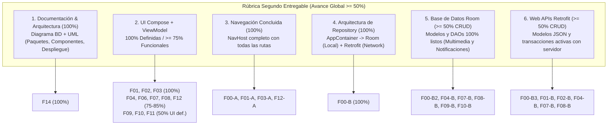
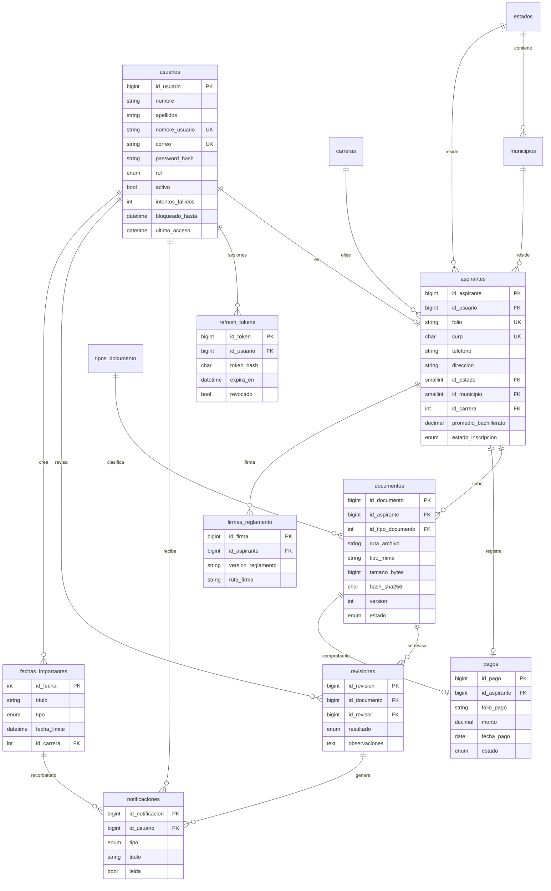

# Especificación de Features — Sistema de Inscripciones ITSUR (Nuevo Ingreso)

**Materia:** Programación Móvil I · **Profesor:** Gustavo Iván Vega Olvera · **Semestre:** 7°
**Equipo:** Montserrat Tenorio Villagómez · Alan Yael Fonseca Ruiz · Dafne Guadalupe Orozco Aguirre
**Fecha del documento:** 02/11/2026
---

## 1. Arquitectura y decisiones técnicas



| Capa | Decisión |
| :--- | :--- |
| **Cliente móvil** | Android, **Kotlin + Jetpack Compose**; Java permitido para utilidades (validadores, helpers de PDF). `minSdk 29`. |
| **Flujo de dependencias** | `Application → Activity → Compose → ViewModel → Repository → (Local Room \| Remote Retrofit)`. Contenedor manual (`AppContainer`, ya existente) con `ViewModelProvider.Factory`; Hilt es opcional. |
| **Servidor** | **Node.js independiente (API REST), sin código Kotlin/Java en el servidor.** Expone el CRUD por HTTP. |
| **Base de datos** | **MySQL 8** (InnoDB, utf8mb4). Partida de `bd_inscripciones_itsur.sql` + migración de la sección 4. |
| **Autenticación** | JWT de acceso (15 min) + refresh token (7 días) guardado con hash; contraseñas con `bcrypt`. |
| **Contrato API** | Prefijo `/api/v1`, JSON UTF-8, `multipart/form-data` para archivos, errores `{ "error": { "code", "message", "details" } }`. |
| **Roles** | `aspirante` y `escolar` (= "administrador" del spec). Un solo login para ambos; la app enruta según `rol`. |

**Stack Node.js propuesto:** `express`, `mysql2`, `jsonwebtoken`, `bcrypt`, `multer`, `zod` (validación), `pdf-lib` (integridad de PDF), `helmet`, `cors`, `express-rate-limit`, `compression`, `pino`, `dotenv`, `node-cron` (recordatorios de fechas).

**Estructura sugerida del servidor (`/server`):**
```text
server/
├─ src/
│  ├─ app.js · server.js · config/ (env, db)
│  ├─ middlewares/ (auth, role, upload, validate, error)
│  ├─ modules/{auth,aspirantes,documentos,revisiones,notificaciones,fechas,pagos,firma,catalogos}/
│  │     ├─ *.routes.js · *.controller.js · *.service.js · *.repository.js · *.schema.js
│  └─ jobs/ (recordatorios.cron.js)
├─ database/ (schema.sql, migrations/V2__*.sql, seeds/)
├─ uploads/ (fuera de git)
└─ tests/ (supertest)
```

---

## 2. Brechas detectadas entre insumos

### 2.1 Pantallas de referencia (capturas) vs. repositorio

| Pantalla | Captura | Repositorio actual |
| :--- | :--- | :--- |
| **Login** | Banner rosa "ITSUR · Inscripciones de Nuevo Ingreso", título "Iniciar Sesión", campos *Usuario o Correo* y *Contraseña* con íconos, botón "Ingresar", enlace "¿No tienes cuenta? Regístrate aquí". | [LoginScreen.kt](app/src/main/java/com/example/proyecto_appmovil/ui/screens/auth/LoginScreen.kt): solo un título y 2 botones, sin campos. |
| **Menú Principal** | TopAppBar vino "Menú Principal" con ícono de cerrar sesión; tarjeta de bienvenida "¡Bienvenido, Aspirante!"; 6 tarjetas de opción (ícono, título, descripción, chevron): Carga de Documentos, Estatus de Inscripción, Datos Personales, Notificaciones y Fechas, Foto para Credencial, Comprobante de Pago (lista con scroll). | [HomeScreen.kt](app/src/main/java/com/example/proyecto_appmovil/ui/screens/home/HomeScreen.kt): 6 botones planos + "Cerrar Sesión". |
| **Tema** | Paleta ciruela/rosa (ver abajo). | [Color.kt](app/src/main/java/com/example/proyecto_appmovil/ui/theme/Color.kt): paleta azul-gris provisional. |




> [!IMPORTANT]
> Ese avance de UI existe solo en el equipo/dispositivo de quien lo desarrolló. **Acción F00-01:** hacer commit del código de ambas pantallas (y su tema) antes de seguir; este documento las toma como diseño oficial y las marca como "UI hecha, falta lógica".

**Paleta oficial definitiva Azul y Gris (aprobada para el 2do Entregable):**

Se sustituyó la paleta preliminar ciruela/rosa por la escala cromática azul-gris institucional seleccionada:

| Token / Rol | Hex | Descripción / Uso |
| :--- | :---: | :--- |
| **`ColorAzulCielo` (`ItsurRosaPastel`)** | `#ACD0F2` | Banner de bienvenida, contenedores principales activos y fondos destacados. |
| **`ColorAzulPastel` (`ItsurRosaSuave`)** | `#A7C7E4` | Tarjetas de opción del menú principal y contenedores secundarios. |
| **`ColorAzulAcero`** | `#A2BDD7` | Contenedores terciarios, elevación sutil y bordes suaves. |
| **`ColorGrisAzulado1`** | `#9EB4CA` | Chips informativos de estado y variantes de superficie. |
| **`ColorGrisAzulado2`** | `#99ABBE` | Botones secundarios y acentos gráficos. |
| **`ColorPizarra`** | `#94A3B1` | Contornos y énfasis secundario. |
| **`ColorGrisFrio` (`ItsurOutline`)** | `#8A9198` | Bordes de inputs `OutlinedTextField` y divisores. |
| **`ColorGrisMedio` (`ItsurOnSurfaceVariant`)** | `#85898C` | Texto secundario y etiquetas informativas. |
| **`ColorGrisNeutro`** | `#808080` | Íconos inactivos y elementos neutros. |
| **Primario Institucional (`ItsurCiruela`)** | `#1E3A5F` | TopAppBar y botones primarios con texto blanco (contraste WCAG AAA). |
| **Títulos (`ItsurVinoOscuro`)** | `#112233` | Títulos y tipografía de máxima jerarquía. |

### 2.2 Spec vs. BD vs. App (inconsistencias a resolver)

| # | Tema | Spec | `bd_inscripciones_itsur.sql` | Repo (modelos/DTO) | Resolución propuesta |
| :-: | :--- | :--- | :--- | :--- | :--- |
| 1 | Nombre de usuario | Requerido; login con "usuario o correo" | No existe; ejemplo de login por `folio` | Login por `email` | Agregar `usuarios.nombre_usuario` único; login acepta usuario **o** correo. |
| 2 | Dirección, estado, municipio | Requeridos en registro | No existen | `Aspirante.direccion` solo | Agregar `direccion` + catálogos `estados`/`municipios`. |
| 3 | Correo | Obligatorio | `NULL` permitido | — | Hacerlo `NOT NULL`. |
| 4 | Nombre | "Nombre completo" | `nombre` + `apellidos` | `nombreCompleto` | UI con 2 campos (Nombre(s), Apellidos); app compone `nombreCompleto` para mostrar. |
| 5 | Carreras | 8 carreras ITSUR | Tabla sin datos | `carrera: String` | Seed de 8 carreras; la app usa `idCarrera` (Dropdown desde API). |
| 6 | Documentos obligatorios | CURP, Acta, Certificado | + Comprobante de domicilio | 7 tipos en `TipoDocumento` | Obligatorios: CURP, Acta, Certificado. Domicilio, foto, firma y pago se modelan (ver sección 4) y su obligatoriedad la define Control Escolar vía `tipos_documento.obligatorio`. |
| 7 | Estado de documento | Aceptado / Rechazado por *x* razón / **Requiere corrección** | `pendiente, aprobado, rechazado, presencial` | `PENDIENTE, SUBIDO, VALIDADO, RECHAZADO` | Agregar `requiere_correccion`; mapa documentado en 4.4. |
| 8 | Estado de inscripción | — | `en_captura, en_revision, con_observaciones, documentacion_aprobada` | `PENDIENTE, EN_REVISION, CON_OBSERVACIONES, ACEPTADO, RECHAZADO` | Agregar `rechazado`; mapa en 4.4. |
| 9 | Fechas importantes | Límite de entrega y de correcciones | No existe tabla | No existe | Crear `fechas_importantes`. |
| 10 | Foto / Firma / Pago | "No funcionales" del spec | No existen | Pantallas Foto y Pago; sin firma | Foto y firma como documentos/tabla; `pagos`. Se tratan como features completas (F09–F11). |
| 11 | Sesión | — | No existe | Sin token persistido | Crear `refresh_tokens`; app guarda tokens cifrados. |
| 12 | IDs | — | `BIGINT` | `String` | Entidades Room usan `Long` (`idRemoto`) para alinear con MySQL. |
| 13 | Endpoints | — | — | `InscripcionesApiService` cubre solo 4 llamadas | Contrato completo en sección 5. |

---

## 3. Mapa de features y control de avance

> [!TIP]
> **Sistema interactivo de seguimiento de actividades:**
> - En cada sub-actividad puedes marcar el checkbox `- [ ]` a `- [x]` al completarla.
> - El porcentaje entre corchetes `[  0%]` se actualiza directamente conforme avances (ejemplo: `[ 50%]`, `[100%]`).
> - La columna **% Meta E2** indica el nivel mínimo obligatorio que debe quedar realizado para cumplir al 100% con los criterios del **Segundo Entregable**.

| ID | Feature | Prioridad E2 | % Meta E2 | % Actual | Estado | Criterio de Aceptación E2 Cubierto |
| :-: | :--- | :-: | :-: | :-: | :-: | :--- |
| **F00** | Fundaciones (Gradle, DI, tema, servidor, BD) | Must | **100%** | 15% | `[~] En progreso` | Arquitectura, DI Container, Room y Retrofit base |
| **F01** | Autenticación (login unificado) | Must | **100%** | 5% | `[~] En progreso` | UI funcional (100%), sesión en Room/API, NavHost |
| **F02** | Registro de aspirante | Must | **100%** | 5% | `[~] En progreso` | UI funcional (100%), catálogos Room/API, CRUD alta |
| **F03** | Menú principal (dashboard) | Must | **100%** | 20% | `[~] En progreso` | UI funcional (100%), NavHost, Flow Room |
| **F04** | Carga de documentos | Must | **85%** | 0% | `[ ] Pendiente` | UI funcional (85%), CRUD Room local + Web API |
| **F05** | Validación automática y compresión | Must (base) | **75%** | 0% | `[ ] Pendiente` | Integridad de PDF, MIME, tamaño, SHA-256 |
| **F06** | Estatus del proceso | Must | **80%** | 0% | `[ ] Pendiente` | UI funcional (80%), Stepper, Room + API sync |
| **F07** | Datos personales (aspirante y admin) | Must | **85%** | 0% | `[ ] Pendiente` | UI funcional (85%), CRUD perfil en Room y API |
| **F08** | Notificaciones y fechas importantes | Must | **85%** | 0% | `[ ] Pendiente` | Modelos y DAOs 100%, CRUD local y remoto |
| **F09** | Foto para credencial | Should | **50%** | 0% | `[ ] Pendiente` | UI definida (100%), modelo/DAO multimedia 100% |
| **F10** | Comprobante de pago | Should | **50%** | 0% | `[ ] Pendiente` | UI definida (100%), modelo/DAO multimedia 100% |
| **F11** | Firma del reglamento institucional | Could | **40%** | 0% | `[ ] Pendiente` | UI definida (100%), trazo en Canvas base |
| **F12** | Panel de revisión (Control Escolar) | Must (mínimo) | **75%** | 0% | `[ ] Pendiente` | UI funcional (75%), revisión y cambio de estado |
| **F13** | Diseño adaptable | Should | **50%** | 0% | `[ ] Pendiente` | Portrait/landscape sin pérdida de estado |
| **F14** | Documentación y arquitectura | Must | **100%** | 0% | `[ ] Pendiente` | Diagramas BD, Paquetes, Componentes, Despliegue |

**Métrica global:**
- **Avance actual ponderado del negocio en repositorio:** **~4.7%**
- **Avance mínimo requerido para el Segundo Entregable:** **≥ 50.0%**
- **Avance global proyectado con el cumplimiento de las metas E2:** **~68.5%** *(supera el umbral mínimo del 50% y blinda la calificación)*.

Cada feature se divide en **A) Frontend app móvil** (Compose + ViewModel), **B) Backend app móvil** (Repository, Room, Retrofit, DI) y **C) Backend servidor Node.js** (endpoints, servicios, SQL).

---

### 3.1 Criterios de Aceptación del Segundo Entregable (E2) — Metas Específicas por Feature

A continuación se detalla con precisión matemática qué features y hasta qué porcentaje deben quedar concluidas para satisfacer cada uno de los 7 criterios de evaluación del profesor:



#### 1. Documento de requerimientos y arquitectura (Meta: 100%)
* **Criterio oficial:** Tener completado el documento de requerimientos y arquitectura de la aplicación (Diagramas de Base de datos y UML: Diagrama de paquetes, componentes y despliegue).
* **Features involucradas:** **F14 (100%)**.
* **Requisitos a entregar:**
  - Este documento `FEATURES_PROYECTO_INSCRIPCIONES.md` completo y actualizado.
  - Diagrama de Base de Datos relacional (E-R y relacional con tipos de datos, llaves y restricciones).
  - Diagrama UML de Paquetes (estructura organizada de `com.example.proyecto_appmovil`).
  - Diagrama UML de Componentes (flujo `Application -> Activity -> NavHost / Compose -> ViewModel -> Repository -> Room / Retrofit`).
  - Diagrama UML de Despliegue (nodo cliente Android, nodo servidor Node.js/Express, nodo MySQL y almacenamiento `/uploads`).

#### 2. UIs (Compose + ViewModel) 100% definidas y ≥ 75% funcionales
* **Criterio oficial:** Tener el 100% de las UI (Compose + ViewModel) definidas y al menos el 75% funcionales.
* **Features involucradas:** **F01 a F12**.
* **Desglose de cumplimiento:**
  - **100% de UIs definidas (11 pantallas del sistema):**
    1. `LoginScreen` + `LoginViewModel` (F01)
    2. `RegisterScreen` + `RegisterViewModel` (F02)
    3. `HomeScreen` (Menú Principal) + `HomeViewModel` (F03)
    4. `DocumentsScreen` + `DocumentsViewModel` (F04)
    5. `StatusScreen` + `StatusViewModel` (F06)
    6. `ProfileScreen` + `ProfileViewModel` (F07)
    7. `NotificationsScreen` + `NotificationsViewModel` (F08)
    8. `CredentialPhotoScreen` + `CredentialPhotoViewModel` (F09)
    9. `PaymentScreen` + `PaymentViewModel` (F10)
    10. `ReglamentoScreen` + `ReglamentoViewModel` (F11)
    11. `AdminHomeScreen` + `AdminHomeViewModel` (F12)
  - **≥ 75% Funcionales:**
    - **100% funcionales:** F01 (Login), F02 (Registro), F03 (Dashboard con contadores en vivo).
    - **80% a 85% funcionales:** F04 (Carga y listado de documentos PDF), F06 (Estatus con stepper en vivo), F07 (Perfil editable), F08 (Avisos y fechas límite), F12 (Revisión básica de documentos y cambio de estado).
    - **50% funcionales (UI definida + interactividad base):** F09 (Cámara/selector de foto y recorte), F10 (Ficha de pago y captura de folio), F11 (Canvas interactivo para dibujar firma).

#### 3. Navegación concluida al 100% (NavHost)
* **Criterio oficial:** Navegación concluida (NavHost).
* **Features involucradas:** **F00-A, F01-A4, F03-A4, F12-A5 (Meta: 100%)**.
* **Requisitos a entregar:**
  - `AppNavHost` con grafo de navegación cerrado que enlace todas las 11 pantallas.
  - Enrutamiento por rol: `aspirante` navega a `HomeScreen`; `escolar` navega a `AdminHomeScreen`.
  - Paso de argumentos tipados (ej. `idAspirante`, `idDocumento`).
  - Limpieza de pila de navegación (`popUpTo(0)` al cerrar sesión y `popUpTo(Login)` al completar login/registro).

#### 4. Arquitectura de Repository e Inyección de Dependencias (Meta: 100%)
* **Criterio oficial:** Arquitectura de Repository implementado con Repository Local (sqlite-room), Repository Network (Retrofit). Manejo de dependencias de cada componente de la arquitectura: `application -> activity -> compose -> viewmodel -> repository -> repository local / repository remote`.
* **Features involucradas:** **F00-B1 a F00-B6 (Meta: 100%)**.
* **Requisitos a entregar:**
  - `InscripcionesApp` inicializa el `AppContainer`.
  - `DefaultAppContainer` provee instancias únicas de `AppDatabase`, `InscripcionesApiService` y `InscripcionesRepositoryImpl`.
  - `MainActivity` y `AppNavHost` inyectan el repositorio a los ViewModels mediante `AppViewModelProvider.Factory`.
  - Cada ViewModel expone un `StateFlow<UiState>` desacoplado de la vista.
  - El repositorio coordina el acceso a datos locales (Room) y remotos (Retrofit).

#### 5. Bases de datos Room: Entidades, DAOs, Database transaccionando (Meta: ≥ 50% CRUD y 100% modelos)
* **Criterio oficial:** Implementación del manejo de bases de datos. Entidades, DAOS, base de Datos. Su aplicación ya debe transaccionar con la base de datos. Realizar al menos un 50% de avance en las funcionalidades de base de datos de todas las funcionalidades de la aplicación (Agregar, editar, ver, eliminar, listar notas/tareas). Tener el modelo y daos listos para notificaciones y multimedia.
* **Features involucradas:** **F00-B2, F01-B3, F02-B3, F04-B2, F07-B2, F08-B2, F09-B2, F10-B2**.
* **Requisitos a entregar:**
  - `@Database` `AppDatabase` funcional con `TypeConverters` y versión 1.
  - **100% Modelos y DAOs listos para Notificaciones y Multimedia:**
    - Notificaciones: `NotificacionEntity`, `NotificacionDao`, `FechaImportanteEntity`, `FechaImportanteDao`.
    - Multimedia: `DocumentoEntity` (almacena rutas de PDFs y tipo MIME), `ComprobantePagoEntity` (ruta local del archivo, folio, monto), `FotoEntity` / campo en `AspiranteEntity` o `DocumentoEntity` con tipo `FOTO_CREDENCIAL`.
  - **≥ 50% de operaciones CRUD activas en Room:**
    - **Agregar (Create):** Insertar aspirante/usuario en registro, insertar documento subido localmente, insertar comprobante de pago.
    - **Editar (Update):** Actualizar datos del aspirante en Room, marcar notificación como leída (`leida = true`).
    - **Ver / Listar (Read):** Observar aspirante activo con `Flow`, listar documentos del aspirante con `Flow`, listar notificaciones y fechas importantes.
    - **Eliminar (Delete):** Eliminar documento local no validado, eliminar notificación leída.

#### 6. Interacción con Web APIs con Retrofit (Meta: ≥ 50% transaccional)
* **Criterio oficial:** Implementación del manejo de retrofit para el consumo de una web api. Modelos, Configuración de JSON. Su aplicación ya debe transaccionar con la Web. Realizar al menos un 50% de avance en las funcionalidades de las peticiones a la web api con funcionalidades de la aplicación (Agregar, editar, ver, eliminar, listar, recuperar).
* **Features involucradas:** **F00-B3, F01-B2, F02-B2, F04-B3, F07-B3, F08-B3, F10-B3**.
* **Requisitos a entregar:**
  - `RetrofitClient` con `OkHttpClient`, logging y `GsonConverterFactory`.
  - DTOs serializables con `@SerializedName` para todas las peticiones y respuestas.
  - **≥ 50% de peticiones Web API transaccionando:**
    - **Agregar (POST):** `/auth/register` (crear cuenta), `/aspirantes/me/documentos` (subir archivo multipart), `/aspirantes/me/pago` (registrar pago).
    - **Editar (PUT/PATCH):** `/aspirantes/me` (actualizar datos personales), `/notificaciones/:id/leida` (marcar leída).
    - **Ver / Listar (GET):** `/catalogos/carreras`, `/catalogos/estados`, `/catalogos/municipios`, `/aspirantes/me/resumen`, `/aspirantes/me/documentos`, `/notificaciones`, `/fechas-importantes`.
    - **Eliminar (DELETE):** `/documentos/:id`, `/notificaciones/:id`.
    - **Recuperar (Auth/Sync):** `/auth/login` (recuperar token y sesión), `/auth/refresh` (rotación de tokens), `/aspirantes/me/estatus`.

---

## F00 — Fundaciones del proyecto

> **Control de Avance:** `🟡 En progreso` · **Avance Actual:** `15%` · **Meta Entregable 2:** `100%` · **Prioridad E2:** `Must`
> *(Marca con `[x]` las actividades completadas y actualiza el porcentaje `[XX%]` conforme avances).*

**A) Frontend app móvil**
- [ ] **[ 50%]** **F00-A1**: Integrar el código de las pantallas de referencia (Login y Menú Principal) al repo y unificar el tema ciruela/rosa en `Color.kt` y `Theme.kt` (desactivar `dynamicColor` para respetar la marca).
- [ ] **[  0%]** **F00-A2**: Componentes reutilizables: `ItsurTextField` (ícono, error, teclado), `PrimaryButton`, `OptionCard`, `StatusChip`, `LoadingOverlay`, `ErrorBanner`, `EmptyState`, `ItsurTopBar`.
- [ ] **[  0%]** **F00-A3**: `UiState` genérico (`Loading | Success | Error`) y manejo de mensajes (`Snackbar`).

**B) Backend app móvil**
- [ ] **[ 20%]** **F00-B1**: Gradle: KSP, Room (`runtime`, `ktx`, `compiler`), Retrofit, `converter-gson` (o kotlinx-serialization), `logging-interceptor`, `coroutines`, `datastore-preferences`, `security-crypto`, `coil` (previsualización de imagen), `work-runtime` (cola de subida).
- [ ] **[ 15%]** **F00-B2**: `AppDatabase` (`@Database`, versión 1, `TypeConverters`), `Room.databaseBuilder` en `DefaultAppContainer`.
- [ ] **[  0%]** **F00-B3**: `RetrofitClient` con `OkHttpClient` (timeouts, logging solo en debug, `AuthInterceptor` que añade `Authorization: Bearer`, `Authenticator` que usa refresh token), `BASE_URL` por `buildConfigField` (emulador `http://10.0.2.2:3000/api/v1/`).
- [ ] **[ 15%]** **F00-B4**: `AppViewModelProvider.Factory` (`viewModelFactory { initializer { … } }`) y `InscripcionesRepositoryImpl(daos, apiService, sessionStore)`.
- [ ] **[  0%]** **F00-B5**: `SessionStore` (DataStore + EncryptedSharedPreferences): tokens, `idUsuario`, `rol`.
- [ ] **[  0%]** **F00-B6**: Wrapper `NetworkResult<T>` / mapeo de errores HTTP → mensajes de usuario; `ConnectivityObserver`.
- [ ] **[  0%]** **F00-B7**: Manifest: `INTERNET`, `ACCESS_NETWORK_STATE`, `networkSecurityConfig` solo para dev (cleartext a `10.0.2.2`), `POST_NOTIFICATIONS`.

**C) Backend servidor Node.js**
- [ ] **[  0%]** **F00-C1**: Proyecto `server/` con la estructura de la sección 1, `.env.example` (`PORT`, `DB_*`, `JWT_SECRET`, `JWT_REFRESH_SECRET`, `UPLOAD_DIR`, `MAX_PDF_MB`), `npm scripts` (`dev`, `start`, `test`, `migrate`).
- [ ] **[  0%]** **F00-C2**: Pool `mysql2/promise`, transacciones con helper `withTransaction`, health check `GET /health`.
- [ ] **[  0%]** **F00-C3**: Middlewares globales: `helmet`, `cors`, `compression`, `express-rate-limit` (más estricto en `/auth`), `pino-http`, manejador central de errores.
- [ ] **[  0%]** **F00-C4**: Aplicar migración de BD (sección 4) y seeds (carreras, tipos de documento, estados/municipios de Guanajuato mínimo).
- [ ] **[  0%]** **F00-C5**: Usuario `escolar` semilla (script `npm run seed:admin`).

**Criterios de aceptación:** el proyecto compila sin errores; la app abre Login con el diseño de referencia; `GET /health` responde 200; la BD migrada se crea desde cero con un solo script.

---

## F01 — Autenticación (login unificado aspirante / administrador)

> **Control de Avance:** `🟡 En progreso` · **Avance Actual:** `5%` · **Meta Entregable 2:** `100%` · **Prioridad E2:** `Must`
> *(Marca con `[x]` las actividades completadas y actualiza el porcentaje `[XX%]` conforme avances).*

**Reglas:** un único login ("Usuario o Correo" + contraseña) para ambos roles; la app navega según `rol` devuelto (`aspirante` → Menú Principal; `escolar` → Panel de revisión F12). Bloqueo temporal tras 5 intentos fallidos.

**A) Frontend app móvil**
- [ ] **[ 25%]** **F01-A1**: `LoginScreen` según captura: banner ITSUR, campos con íconos (usuario / candado), botón "Ingresar", enlace a registro.
- [ ] **[  0%]** **F01-A2**: Mostrar/ocultar contraseña, teclado `Done` envía el formulario, botón deshabilitado con `Loading`.
- [ ] **[  0%]** **F01-A3**: Validaciones en vivo: campo requerido; mensajes de error del servidor (credenciales inválidas, cuenta inactiva, cuenta bloqueada).
- [ ] **[  0%]** **F01-A4**: Sesión persistente: si hay token vigente, `AppNavHost` arranca en Home/Panel; cerrar sesión (ícono de la barra) limpia tokens y base local y vuelve a Login con `popUpTo(0)`.

**B) Backend app móvil**
- [ ] **[ 15%]** **F01-B1**: `LoginViewModel`: `LoginUiState(usuario, contrasena, isLoading, error)`, evento `onLoginClick`, efecto `NavigateToHome(rol)`.
- [ ] **[  0%]** **F01-B2**: `InscripcionesApiService.login(LoginRequestDto(identificador, contrasena))` → `LoginResponseDto(accessToken, refreshToken, usuario, rol, aspirante?)`.
- [ ] **[  0%]** **F01-B3**: Repositorio: llama a remoto, guarda tokens en `SessionStore`, guarda/actualiza `UsuarioEntity`/`AspiranteEntity` en Room.
- [ ] **[  0%]** **F01-B4**: `logout()` → llamada `POST /auth/logout`, limpieza de Room (`clearAllTables`) y de `SessionStore`.
- [ ] **[  0%]** **F01-B5**: Autenticator OkHttp: ante 401 intenta `POST /auth/refresh`; si falla, fuerza logout.

**C) Backend servidor Node.js**
- [ ] **[  0%]** **F01-C1**: `POST /auth/login` — busca por `nombre_usuario` **o** `correo` (no distingue mayúsculas), valida `activo`, compara `bcrypt`, controla `intentos_fallidos`/`bloqueado_hasta`, emite JWT + refresh (guarda hash en `refresh_tokens`), actualiza `ultimo_acceso`.
- [ ] **[  0%]** **F01-C2**: `POST /auth/refresh` (rotación del refresh token), `POST /auth/logout` (revoca), `GET /auth/me`.
- [ ] **[  0%]** **F01-C3**: Middlewares `requireAuth` y `requireRole('escolar'|'aspirante')`.
- [ ] **[  0%]** **F01-C4**: Respuestas de error homogéneas (`INVALID_CREDENTIALS`, `ACCOUNT_LOCKED`, `ACCOUNT_DISABLED`).

**Criterios de aceptación:** con credenciales válidas se llega a la pantalla correcta según rol; con inválidas se muestra el error; al reabrir la app la sesión persiste; el token expirado se renueva sin que el usuario lo note.

---

## F02 — Registro de aspirante ("¿No tienes cuenta? Regístrate aquí")

> **Control de Avance:** `🟡 En progreso` · **Avance Actual:** `5%` · **Meta Entregable 2:** `100%` · **Prioridad E2:** `Must`
> *(Marca con `[x]` las actividades completadas y actualiza el porcentaje `[XX%]` conforme avances).*

**Campos (spec):** nombre(s), apellidos, nombre de usuario, correo, contraseña (+ confirmación), CURP, dirección, estado, municipio, carrera (DropdownMenu con las 8 carreras), teléfono (opcional).

Carreras: Ing. Sistemas Computacionales · Ing. Sistemas Automotrices · Ing. Ambiental · Lic. Gestión Empresarial · Ing. Industrial · Ing. Electrónica · Ing. Semiconductores · Lic. Gastronomía y Turismo.

**A) Frontend app móvil**
- [ ] **[ 20%]** **F02-A1**: `RegisterScreen` con formulario desplazable y mismo estilo que Login; dropdowns de Estado → Municipio (dependiente) y Carrera.
- [ ] **[  0%]** **F02-A2**: Validaciones por campo con mensaje bajo el input: CURP (regex oficial de 18 caracteres), correo, usuario (3–30, alfanumérico/`_`/`.`), contraseña (≥ 8, mayúscula, minúscula, número), confirmación, teléfono (10 dígitos).
- [ ] **[  0%]** **F02-A3**: Estados de UI: enviando, éxito (navegar a Home con sesión iniciada), error de campo duplicado (usuario/correo/CURP ya registrados).

**B) Backend app móvil**
- [ ] **[ 15%]** **F02-B1**: `RegisterViewModel` con `RegisterUiState` y validadores (clase utilitaria, puede ir en Java: `CurpValidator`).
- [ ] **[  0%]** **F02-B2**: `RegisterRequestDto` ampliado (`nombre, apellidos, nombreUsuario, correo, contrasena, curp, direccion, idEstado, idMunicipio, idCarrera, telefono`).
- [ ] **[  0%]** **F02-B3**: Repositorio de catálogos: `getCarreras()`, `getEstados()`, `getMunicipios(idEstado)` — remoto con caché en Room (`CarreraEntity`, `EstadoEntity`, `MunicipioEntity`) para uso offline.
- [ ] **[  0%]** **F02-B4**: Al registrarse con éxito: guardar sesión + aspirante en Room (mismo flujo que login).

**C) Backend servidor Node.js**
- [ ] **[  0%]** **F02-C1**: `POST /auth/register` — validación `zod`; transacción: inserta `usuarios` (rol `aspirante`, hash bcrypt cost 10+) y `aspirantes` (folio generado `ITSUR-{AAAA}-{00001}`, estado `en_captura`); responde igual que login.
- [ ] **[  0%]** **F02-C2**: Errores de unicidad mapeados: `USERNAME_TAKEN`, `EMAIL_TAKEN`, `CURP_TAKEN` (código `ER_DUP_ENTRY` de MySQL → 409).
- [ ] **[  0%]** **F02-C3**: `GET /catalogos/carreras`, `GET /catalogos/estados`, `GET /catalogos/municipios?idEstado=`.
- [ ] **[  0%]** **F02-C4**: Generación de folio segura frente a concurrencia (secuencia por año en tabla `folios_secuencia` o `SELECT … FOR UPDATE` dentro de la transacción).

**Criterios de aceptación:** un aspirante nuevo queda en MySQL y en Room; no se pueden duplicar usuario/correo/CURP; las listas de carrera/estado/municipio provienen de la API y funcionan sin red tras la primera carga.

---

## F03 — Menú principal (dashboard del aspirante)

> **Control de Avance:** `🟡 En progreso` · **Avance Actual:** `20%` · **Meta Entregable 2:** `100%` · **Prioridad E2:** `Must`
> *(Marca con `[x]` las actividades completadas y actualiza el porcentaje `[XX%]` conforme avances).*

**A) Frontend app móvil**
- [ ] **[ 40%]** **F03-A1**: `HomeScreen` según captura: `Scaffold` + `ItsurTopBar("Menú Principal")` con acción de cerrar sesión; `LazyColumn` con tarjeta de bienvenida y 6 `OptionCard` (ícono, título, descripción, chevron): Carga de Documentos, Estatus de Inscripción, Datos Personales, Notificaciones y Fechas, Foto para Credencial, Comprobante de Pago.
- [ ] **[  0%]** **F03-A2**: Personalizar el saludo con el nombre del aspirante ("¡Bienvenido, {nombre}!"), mostrar el folio y una insignia con el número de notificaciones sin leer en la tarjeta *Notificaciones y Fechas*.
- [ ] **[  0%]** **F03-A3**: Mini-resumen de progreso (documentos aprobados / requeridos) en la tarjeta de bienvenida.
- [ ] **[  0%]** **F03-A4**: Si el rol es `escolar`, `AppNavHost` muestra el Panel de revisión (F12) en lugar de este menú.

**B) Backend app móvil**
- [ ] **[ 15%]** **F03-B1**: `HomeViewModel` combina flujos de Room: `aspirante`, `conteoNoLeidas`, `progresoDocumentos` (`Flow`), y dispara una sincronización silenciosa al abrir.
- [ ] **[  0%]** **F03-B2**: `SyncUseCase`/`repository.refreshDashboard()`: llama `GET /aspirantes/me/resumen` y actualiza Room.

**C) Backend servidor Node.js**
- [ ] **[  0%]** **F03-C1**: `GET /aspirantes/me/resumen` → `{ nombre, folio, estadoInscripcion, documentos: { requeridos, aprobados, pendientes, rechazados }, notificacionesNoLeidas, proximaFechaLimite }` (una consulta agregada).

**Criterios de aceptación:** pantalla idéntica a la captura con datos reales; contador de notificaciones correcto; cerrar sesión funciona.

---

## F04 — Carga de documentos (CURP, Acta de nacimiento, Certificado de bachillerato)

> **Control de Avance:** `⚪ Pendiente` · **Avance Actual:** `0%` · **Meta Entregable 2:** `85%` · **Prioridad E2:** `Must`
> *(Marca con `[x]` las actividades completadas y actualiza el porcentaje `[XX%]` conforme avances).*

**Reglas:** formato PDF; peso máximo configurable (por defecto 5 MB); selección desde memoria del celular o la nube (Drive) mediante Storage Access Framework; cada resubida crea una **nueva versión** (la BD ya soporta `version`); no se puede borrar/reemplazar un documento `aprobado`.

**A) Frontend app móvil**
- [ ] **[  0%]** **F04-A1**: `DocumentsScreen`: lista de `tipos_documento` con tarjeta por documento (título, descripción, obligatorio, `StatusChip` con color por estado, observaciones del revisor, fecha y versión).
- [ ] **[  0%]** **F04-A2**: Botón "Subir / Reemplazar" abre el selector (`ActivityResultContracts.OpenDocument` con `application/pdf`); tras seleccionar, muestra nombre, tamaño y botón "Enviar".
- [ ] **[  0%]** **F04-A3**: Barra de progreso de subida y cancelación; mensajes claros de error de validación (formato, peso, archivo dañado).
- [ ] **[  0%]** **F04-A4**: Acciones: ver archivo (visor externo / `PdfRenderer`), eliminar (solo `pendiente`/`rechazado`/`requiere_correccion`), ver historial de versiones.
- [ ] **[  0%]** **F04-A5**: Pull-to-refresh y estado vacío.

**B) Backend app móvil**
- [ ] **[  0%]** **F04-B1**: `DocumentsViewModel` con `DocumentsUiState` (lista de `DocumentoItem`, archivo seleccionado, progreso, error).
- [ ] **[  0%]** **F04-B2**: `DocumentoEntity` (`idLocal`, `idRemoto`, `idTipoDocumento`, `rutaLocal`, `nombreOriginal`, `tamanoBytes`, `version`, `estado`, `observaciones`, `syncPendiente`) y `DocumentoDao` (insert, update, delete, listar `Flow`, última versión por tipo, pendientes de sync).
- [ ] **[  0%]** **F04-B3**: Retrofit multipart: `@Multipart @POST("aspirantes/me/documentos")`, `@GET`, `@DELETE`, `@GET("documentos/{id}/archivo") @Streaming`.
- [ ] **[  0%]** **F04-B4**: Repositorio: copia el archivo seleccionado a almacenamiento interno de la app (persistir URI no es fiable), valida (F05), comprime, sube; si no hay red, deja `syncPendiente = true` y `WorkManager` reintenta.
- [ ] **[  0%]** **F04-B5**: Copia local en Room para consulta offline del listado y estado.

**C) Backend servidor Node.js**
- [ ] **[  0%]** **F04-C1**: `POST /aspirantes/me/documentos` (multipart: `idTipoDocumento`, `archivo`): `multer` con almacenamiento temporal, validación (F05), cálculo de `version = MAX+1`, guardado final en `uploads/{idAspirante}/{tipo}/v{n}.pdf`, inserción en `documentos` (estado `pendiente`), cambio de `aspirantes.estado_inscripcion` a `en_revision` cuando todos los obligatorios están subidos.
- [ ] **[  0%]** **F04-C2**: `GET /aspirantes/me/documentos` → última versión por tipo + estado + última observación (vista `v_documentos_vigentes`).
- [ ] **[  0%]** **F04-C3**: `GET /aspirantes/me/documentos/:idTipo/historial`, `GET /documentos/:id/archivo` (autorizado: dueño o `escolar`, con `Content-Disposition`), `DELETE /documentos/:id` (restricciones de estado, borra archivo y fila).
- [ ] **[  0%]** **F04-C4**: Notifica a Control Escolar (opcional) y limpia archivos huérfanos si falla la transacción.

**Criterios de aceptación:** un aspirante sube los 3 documentos y se ven en la lista con su estado; los archivos inválidos se rechazan con mensaje claro; las versiones se conservan; sin red se encola y se envía al reconectar.

---

## F05 — Validación automática y compresión de archivos

> **Control de Avance:** `⚪ Pendiente` · **Avance Actual:** `0%` · **Meta Entregable 2:** `75%` · **Prioridad E2:** `Must (base)`
> *(Marca con `[x]` las actividades completadas y actualiza el porcentaje `[XX%]` conforme avances).*

**A) Frontend app móvil**
- [ ] **[  0%]** **F05-A1**: Mostrar resultado de validación previa a la subida (✔ formato, ✔ peso, ✔ legible) con mensajes accionables.

**B) Backend app móvil**
- [ ] **[  0%]** **F05-B1**: `PdfValidator` (utilidad Kotlin/Java): extensión y `mimeType` = `application/pdf`; cabecera `%PDF-`; tamaño ≤ límite; abrir con `PdfRenderer` para verificar que no está dañado/protegido y que tiene ≥ 1 página.
- [ ] **[  0%]** **F05-B2**: `FileCompressor`: imágenes (foto F09) → redimensionar máx. 1600 px y JPEG calidad 80; PDF → no se re-codifica en el cliente, se reduce el tráfico con `Content-Encoding: gzip` en la subida; se reporta tamaño original vs. enviado.
- [ ] **[  0%]** **F05-B3**: Calcular `SHA-256` del archivo para detectar duplicados y enviarlo al servidor como verificación de integridad.

**C) Backend servidor Node.js**
- [ ] **[  0%]** **F05-C1**: Servicio `fileValidation`: *magic bytes* `%PDF-`, MIME real (no solo el declarado), límite de tamaño (`MAX_PDF_MB`), lista blanca de tipos por `tipos_documento.formatos_permitidos`, verificación de integridad con `pdf-lib` (carga el documento, cuenta páginas, rechaza cifrados), comparación de `sha256` recibido vs. calculado.
- [ ] **[  0%]** **F05-C2**: Respuestas `422` con `code` (`INVALID_FORMAT`, `FILE_TOO_LARGE`, `CORRUPTED_FILE`, `ENCRYPTED_FILE`, `HASH_MISMATCH`).
- [ ] **[  0%]** **F05-C3**: Compresión de transporte (`compression` middleware) y, opcional/fase 2, optimización del PDF almacenado con Ghostscript/`qpdf` si está disponible; guardar `tamano_original_bytes` y `comprimido`.
- [ ] **[  0%]** **F05-C4**: Nombre de archivo saneado (nunca usar el nombre original en disco; se conserva en `nombre_original`).

**Criterios de aceptación:** PDFs corruptos, de tamaño excesivo o renombrados desde otro formato se rechazan tanto en la app como en el servidor; el servidor no confía en la validación del cliente.

---

## F06 — Estatus del proceso de inscripción

> **Control de Avance:** `⚪ Pendiente` · **Avance Actual:** `0%` · **Meta Entregable 2:** `80%` · **Prioridad E2:** `Must`
> *(Marca con `[x]` las actividades completadas y actualiza el porcentaje `[XX%]` conforme avances).*

**A) Frontend app móvil**
- [ ] **[  0%]** **F06-A1**: `StatusScreen`: estado general con chip (En captura · En revisión · Con observaciones · Documentación aprobada · Rechazado) y descripción.
- [ ] **[  0%]** **F06-A2**: *Stepper* de etapas: Registro → Documentos → Revisión → Pago → Resultado, marcando completadas / actuales / pendientes.
- [ ] **[  0%]** **F06-A3**: Lista de documentos con estado individual y razón de rechazo/corrección; acceso directo a "Corregir" que lleva a F04.
- [ ] **[  0%]** **F06-A4**: Muestra próxima fecha límite (F08).

**B) Backend app móvil**
- [ ] **[  0%]** **F06-B1**: `StatusViewModel` (`StatusUiState`) que combina `aspirante`, `documentos`, `pago`, `fechas` desde Room.
- [ ] **[  0%]** **F06-B2**: `repository.refreshEstatus()` → `GET /aspirantes/me/estatus`, upsert en Room; mapeo de enum servidor → `EstadoInscripcion` / `EstadoDocumento` (tabla 4.4).

**C) Backend servidor Node.js**
- [ ] **[  0%]** **F06-C1**: `GET /aspirantes/me/estatus` → `{ estadoInscripcion, etapas[], documentos[{tipo, estado, observaciones, version}], pago, firma, proximaFechaLimite }`.
- [ ] **[  0%]** **F06-C2**: Regla de cálculo del estado general (servicio `inscripcionService.recalcularEstado(idAspirante)`), invocada tras cada subida o revisión:
  - Falta algún obligatorio → `en_captura`.
  - Todos subidos y alguno `pendiente` → `en_revision`.
  - Alguno `rechazado`/`requiere_correccion`/`presencial` → `con_observaciones`.
  - Todos los obligatorios `aprobado` → `documentacion_aprobada`.
  - Decisión final de Control Escolar → `rechazado` (manual).

**Criterios de aceptación:** el estado mostrado coincide con el de MySQL y se actualiza tras cada revisión.

---

## F07 — Datos personales (ver y editar — aspirante y administrador)

> **Control de Avance:** `⚪ Pendiente` · **Avance Actual:** `0%` · **Meta Entregable 2:** `85%` · **Prioridad E2:** `Must`
> *(Marca con `[x]` las actividades completadas y actualiza el porcentaje `[XX%]` conforme avances).*

**A) Frontend app móvil**
- [ ] **[  0%]** **F07-A1**: `ProfileScreen`: modo lectura con botón "Editar" → modo edición con los mismos campos y validaciones de F02 (nombre, apellidos, usuario, correo, teléfono, dirección, estado, municipio, CURP, carrera). Folio y rol son solo lectura.
- [ ] **[  0%]** **F07-A2**: Sección "Cambiar contraseña" (actual, nueva, confirmación).
- [ ] **[  0%]** **F07-A3**: El administrador ve la misma pantalla con sus datos (sin carrera/CURP); además, desde F12 puede abrir y editar los datos de un aspirante.
- [ ] **[  0%]** **F07-A4**: Confirmación de descartar cambios y mensajes de éxito/error.

**B) Backend app móvil**
- [ ] **[  0%]** **F07-B1**: `ProfileViewModel`: `loadProfile()`, `onFieldChange()`, `save()`, `changePassword()`.
- [ ] **[  0%]** **F07-B2**: `AspiranteDao`: `getById`, `observe`, `update`, `delete`; `UsuarioDao` para el administrador.
- [ ] **[  0%]** **F07-B3**: Retrofit: `GET/PUT /aspirantes/me`, `PUT /usuarios/me/password`; admin: `PUT /admin/aspirantes/{id}`.
- [ ] **[  0%]** **F07-B4**: Estrategia: guardar primero en servidor; si OK, actualizar Room (si sin red, marcar `syncPendiente` y mostrar aviso).

**C) Backend servidor Node.js**
- [ ] **[  0%]** **F07-C1**: `GET /aspirantes/me`, `PUT /aspirantes/me` (validación + unicidad de usuario/correo/CURP excluyendo al propio; bloquear cambio de CURP/carrera cuando el estado es `documentacion_aprobada`).
- [ ] **[  0%]** **F07-C2**: `PUT /usuarios/me/password` (verifica contraseña actual, revoca refresh tokens).
- [ ] **[  0%]** **F07-C3**: `GET /usuarios/me` y `PUT /usuarios/me` para el administrador.
- [ ] **[  0%]** **F07-C4**: `GET /admin/aspirantes/:id` y `PUT /admin/aspirantes/:id` (solo `escolar`).

**Criterios de aceptación:** los cambios persisten en MySQL y Room; el aspirante no puede editar datos ajenos; el administrador puede ver/editar los suyos y los de cualquier aspirante.

---

## F08 — Notificaciones y fechas importantes

> **Control de Avance:** `⚪ Pendiente` · **Avance Actual:** `0%` · **Meta Entregable 2:** `85%` · **Prioridad E2:** `Must`
> *(Marca con `[x]` las actividades completadas y actualiza el porcentaje `[XX%]` conforme avances).*

**Reglas (spec):** notificar fechas límite de entrega y de correcciones, y el estatus de los documentos (Aceptado, Rechazado por *x* razón, Requiere corrección).

**A) Frontend app móvil**
- [ ] **[  0%]** **F08-A1**: `NotificationsScreen` con dos pestañas: **Avisos** (lista con título, mensaje, fecha relativa, punto de no leída, swipe para borrar) y **Fechas** (línea de tiempo con fecha límite y cuenta regresiva; resalta vencidas/próximas).
- [ ] **[  0%]** **F08-A2**: Filtro Todas / No leídas; "Marcar todas como leídas"; tocar una notificación de documento navega a F04/F06.
- [ ] **[  0%]** **F08-A3**: Notificación local del sistema (`NotificationCompat`) para nuevos avisos y recordatorio (p. ej. 3 días y 1 día antes del límite); permiso `POST_NOTIFICATIONS` (Android 13+).

**B) Backend app móvil**
- [ ] **[  0%]** **F08-B1**: `NotificationsViewModel` (`NotificationsUiState`, filtro, eventos).
- [ ] **[  0%]** **F08-B2**: `NotificacionEntity` ampliada (`tipo`, `idDocumento`, `idFecha`, `leida`, `fechaEnvio`) + `NotificacionDao` (insertAll, listar `Flow`, contar no leídas, marcar leída, borrar); `FechaImportanteEntity` + `FechaImportanteDao`.
- [ ] **[  0%]** **F08-B3**: Retrofit: `GET /notificaciones`, `PATCH /notificaciones/{id}/leida`, `PATCH /notificaciones/leer-todas`, `DELETE /notificaciones/{id}`, `GET /fechas-importantes`.
- [ ] **[  0%]** **F08-B4**: Sincronización periódica con `WorkManager` (cada 15–30 min) que descarga notificaciones nuevas y dispara la notificación local; (fase 2: FCM push).
- [ ] **[  0%]** **F08-B5**: Programación de recordatorios locales con `WorkManager`/`AlarmManager` a partir de las fechas.

**C) Backend servidor Node.js**
- [ ] **[  0%]** **F08-C1**: `GET /notificaciones?leida=&page=`, `PATCH …/leida`, `PATCH …/leer-todas`, `DELETE …/:id` (solo del dueño).
- [ ] **[  0%]** **F08-C2**: Servicio `notificacionService.crear()` invocado desde la revisión de documentos (F12) con plantillas: *"Documento {tipo} aprobado"*, *"Documento {tipo} rechazado: {razón}"*, *"Documento {tipo} requiere corrección: {razón}"*.
- [ ] **[  0%]** **F08-C3**: `GET /fechas-importantes` (global o por carrera); admin: `POST/PUT/DELETE /admin/fechas-importantes`. Al crear/editar una fecha se notifica a los aspirantes afectados.
- [ ] **[  0%]** **F08-C4**: Job `node-cron` diario: genera recordatorios a aspirantes que aún no han completado documentos cuando falten 3 y 1 días para la fecha límite (evitar duplicados).
- [ ] **[  0%]** **F08-C5**: (Fase 2) Tabla `dispositivos_fcm` y envío push con Firebase Admin.

**Criterios de aceptación:** al rechazar un documento, el aspirante ve el aviso con la razón; las fechas límite se muestran ordenadas; el contador de no leídas es consistente en Home.

---

## F09 — Foto para credencial escolar

> **Control de Avance:** `⚪ Pendiente` · **Avance Actual:** `0%` · **Meta Entregable 2:** `50%` · **Prioridad E2:** `Should`
> *(Marca con `[x]` las actividades completadas y actualiza el porcentaje `[XX%]` conforme avances).*

**A) Frontend app móvil**
- [ ] **[  0%]** **F09-A1**: `CredentialPhotoScreen`: instrucciones (fondo blanco, rostro frontal, sin lentes/gorra), vista previa de la foto actual y estado de revisión.
- [ ] **[  0%]** **F09-A2**: Botones "Tomar foto" (cámara, `ActivityResultContracts.TakePicture` con `FileProvider`; permiso `CAMERA` gestionado) y "Elegir de galería" (`PickVisualMedia`).
- [ ] **[  0%]** **F09-A3**: Recorte/encuadre 3:4 con previsualización antes de confirmar y botón "Enviar".

**B) Backend app móvil**
- [ ] **[  0%]** **F09-B1**: `CredentialPhotoViewModel` (`CredentialPhotoUiState`).
- [ ] **[  0%]** **F09-B2**: `FileCompressor` (F05-B2) → JPEG ≤ 1 MB; guardado local en almacenamiento interno; registro en `DocumentoEntity` con tipo `FOTO_CREDENCIAL`.
- [ ] **[  0%]** **F09-B3**: Subida con el mismo endpoint de documentos (F04) usando el tipo `FOTO_CREDENCIAL` (`image/jpeg`).

**C) Backend servidor Node.js**
- [ ] **[  0%]** **F09-C1**: `tipos_documento.codigo = 'FOTO_CREDENCIAL'`, `formatos_permitidos = image/jpeg,image/png`, tamaño máximo propio.
- [ ] **[  0%]** **F09-C2**: Validación de imagen (magic bytes JPEG/PNG, dimensiones mínimas con `sharp` o `image-size`).
- [ ] **[  0%]** **F09-C3**: Revisión por Control Escolar igual que otros documentos (F12).

**Criterios de aceptación:** la foto se toma/selecciona, se comprime, se sube, y puede aprobarse/rechazarse por Control Escolar.

---

## F10 — Comprobante de pago (ficha de pago que proporciona la escuela)

> **Control de Avance:** `⚪ Pendiente` · **Avance Actual:** `0%` · **Meta Entregable 2:** `50%` · **Prioridad E2:** `Should`
> *(Marca con `[x]` las actividades completadas y actualiza el porcentaje `[XX%]` conforme avances).*

**A) Frontend app móvil**
- [ ] **[  0%]** **F10-A1**: `PaymentScreen`: muestra la **ficha de pago/referencia** asignada por la escuela (folio de referencia y monto, descargables/compartibles); formulario para registrar el pago (folio, monto, fecha de pago) y adjuntar el comprobante (PDF o foto).
- [ ] **[  0%]** **F10-A2**: Estado de validación (`Pendiente`, `Validado`, `Rechazado` con motivo) y edición mientras no esté validado.

**B) Backend app móvil**
- [ ] **[  0%]** **F10-B1**: `PaymentViewModel` con validación (monto > 0, fecha no futura, folio requerido).
- [ ] **[  0%]** **F10-B2**: `ComprobantePagoEntity` (`idRemoto`, `folio`, `monto`, `fechaPago`, `rutaLocal`, `validado`, `observaciones`) + `ComprobantePagoDao` (insert, update, delete, observe).
- [ ] **[  0%]** **F10-B3**: Retrofit: `GET /aspirantes/me/pago`, `POST /aspirantes/me/pago` (multipart), `PUT /aspirantes/me/pago`.

**C) Backend servidor Node.js**
- [ ] **[  0%]** **F10-C1**: Tabla `pagos` (sección 4) y endpoints `GET/POST/PUT /aspirantes/me/pago`; el comprobante se guarda como `documento` (tipo `COMPROBANTE_PAGO`) enlazado por `id_documento`.
- [ ] **[  0%]** **F10-C2**: Admin: `GET /admin/pagos?estado=`, `PATCH /admin/pagos/:id/validacion` (`validado`/`rechazado` + observaciones) que genera notificación.
- [ ] **[  0%]** **F10-C3**: Referencia de pago: campo `referencia_asignada` y `monto_esperado` (capturados por Control Escolar o generados al registrar) para comparar con lo reportado.

**Criterios de aceptación:** el aspirante registra y consulta su pago; Control Escolar lo valida y el aspirante es notificado.

---

## F11 — Firma del reglamento institucional

> **Control de Avance:** `⚪ Pendiente` · **Avance Actual:** `0%` · **Meta Entregable 2:** `40%` · **Prioridad E2:** `Could`
> *(Marca con `[x]` las actividades completadas y actualiza el porcentaje `[XX%]` conforme avances).*

**A) Frontend app móvil**
- [ ] **[  0%]** **F11-A1**: Pantalla (accesible desde Menú → *Datos/Estatus* o como paso del Estatus) con texto/visor del reglamento, casilla "He leído y acepto" y lienzo de firma (`Canvas` + gestos) con botones "Limpiar" y "Firmar".

**B) Backend app móvil**
- [ ] **[  0%]** **F11-B1**: `ReglamentoViewModel`: exporta el trazo a PNG, lo comprime y lo sube; `FirmaReglamentoEntity`/`Dao`.
- [ ] **[  0%]** **F11-B2**: Retrofit: `GET /reglamento` (texto/URL del PDF vigente), `POST /aspirantes/me/firma-reglamento` (multipart PNG), `GET /aspirantes/me/firma-reglamento`.

**C) Backend servidor Node.js**
- [ ] **[  0%]** **F11-C1**: Tabla `firmas_reglamento` (sección 4): una firma por aspirante y versión de reglamento; guarda imagen, fecha, versión y `sha256`.
- [ ] **[  0%]** **F11-C2**: Endpoints anteriores; validar PNG y tamaño; el administrador puede consultar la firma en la revisión.

**Criterios de aceptación:** el aspirante firma una sola vez por versión de reglamento y queda registro auditable.

---

## F12 — Panel de revisión de Control Escolar (rol administrador)

> **Control de Avance:** `⚪ Pendiente` · **Avance Actual:** `0%` · **Meta Entregable 2:** `75%` · **Prioridad E2:** `Must (mínimo)`
> *(Marca con `[x]` las actividades completadas y actualiza el porcentaje `[XX%]` conforme avances).*

> No se detalla visualmente en el spec, pero es indispensable: sin este módulo los estados de documentos y las notificaciones (F06, F08) no pueden cambiar. Mínimo viable para el Entregable 2: listar → ver documento → aprobar/rechazar.

**A) Frontend app móvil**
- [ ] **[  0%]** **F12-A1**: `AdminHomeScreen`: contadores (pendientes por revisar, con observaciones, aprobados) y lista de aspirantes con búsqueda (nombre/folio/CURP) y filtros (estado, carrera).
- [ ] **[  0%]** **F12-A2**: `AdminAspiranteDetailScreen`: datos del aspirante (editables, ver F07), lista de sus documentos y pago/firma.
- [ ] **[  0%]** **F12-A3**: Visor de documento y diálogo de revisión: Aprobar · Rechazar · Requiere corrección · Marcar como presencial, con campo de observaciones (obligatorio al rechazar/corregir).
- [ ] **[  0%]** **F12-A4**: Gestión de fechas importantes (crear, editar, eliminar).
- [ ] **[  0%]** **F12-A5**: Rutas nuevas en `Screen`/`AppNavHost`: `admin_home`, `admin_aspirante/{id}`, `admin_fechas`.

**B) Backend app móvil**
- [ ] **[  0%]** **F12-B1**: ViewModels `AdminHomeViewModel`, `AdminAspiranteDetailViewModel`, `AdminFechasViewModel`; paginación (`Paging 3` o paginación manual).
- [ ] **[  0%]** **F12-B2**: Retrofit: `GET /admin/aspirantes`, `GET /admin/aspirantes/{id}`, `GET /admin/aspirantes/{id}/documentos`, `POST /admin/documentos/{id}/revision`, CRUD `/admin/fechas-importantes`.
- [ ] **[  0%]** **F12-B3**: Los datos de administración no se persisten en Room (solo caché mínima); se consultan siempre en línea.

**C) Backend servidor Node.js**
- [ ] **[  0%]** **F12-C1**: `GET /admin/aspirantes?estado=&idCarrera=&q=&page=&limit=` con totales por estado.
- [ ] **[  0%]** **F12-C2**: `POST /admin/documentos/:id/revision` `{ resultado, observaciones }`: transacción que inserta en `revisiones`, actualiza `documentos.estado`, recalcula `aspirantes.estado_inscripcion` (F06-C2) y crea la notificación (F08-C2). Rechaza revisar documentos `aprobado` sin motivo y exige observaciones cuando `resultado ≠ aprobado`.
- [ ] **[  0%]** **F12-C3**: `GET /admin/aspirantes/:id/documentos` (incluye historial y revisiones).
- [ ] **[  0%]** **F12-C4**: Auditoría básica: registrar `id_revisor` y fecha en cada revisión (ya contemplado en `revisiones`).

**Criterios de aceptación:** un usuario `escolar` inicia sesión, ve aspirantes, rechaza un documento con motivo y el aspirante recibe la notificación y ve el estado actualizado.

---

## F13 — Diseño adaptable a diferentes dispositivos

> **Control de Avance:** `⚪ Pendiente` · **Avance Actual:** `0%` · **Meta Entregable 2:** `50%` · **Prioridad E2:** `Should`
> *(Marca con `[x]` las actividades completadas y actualiza el porcentaje `[XX%]` conforme avances).*

**A) Frontend app móvil**
- [ ] **[  0%]** **F13-A1**: Uso de `WindowSizeClass` (`Compact / Medium / Expanded`): en `Compact` lista de una columna (como la captura); en `Medium/Expanded` cuadrícula de 2–3 columnas en el menú y formularios con ancho máximo (~600 dp) centrado.
- [ ] **[  0%]** **F13-A2**: Soporte de orientación horizontal sin pérdida de estado (`rememberSaveable`, `ViewModel`), `imePadding`/`verticalScroll` en formularios, `windowInsets` / edge-to-edge.
- [ ] **[  0%]** **F13-A3**: Tipografía escalable (sp), objetivos táctiles ≥ 48 dp, contraste AA, `contentDescription` en íconos.
- [ ] **[  0%]** **F13-A4**: Previews `@Preview` para teléfono, plegable y tablet; probar en emuladores de 3 tamaños.

**B) Backend app móvil / C) Servidor:** no aplica; las respuestas paginadas del servidor (`limit`) permiten adaptar tamaños de página.

**Criterios de aceptación:** ninguna pantalla se corta ni pierde datos en teléfono pequeño, tablet y landscape.

---

## F14 — Documentación y calidad

> **Control de Avance:** `⚪ Pendiente` · **Avance Actual:** `0%` · **Meta Entregable 2:** `100%` · **Prioridad E2:** `Must`
> *(Marca con `[x]` las actividades completadas y actualiza el porcentaje `[XX%]` conforme avances).*

**A) Frontend app móvil**
- [ ] **[  0%]** **F14-A1**: Pruebas de UI con `compose-ui-test` para Login, Registro y Documentos (flujos felices y de error).

**B) Backend app móvil**
- [ ] **[  0%]** **F14-B1**: Pruebas unitarias de ViewModels (`kotlinx-coroutines-test`, repositorio *fake*), validadores (`CurpValidator`, `PdfValidator`) y DAOs (`Room.inMemoryDatabaseBuilder`).
- [ ] **[  0%]** **F14-B2**: Pruebas del repositorio con `MockWebServer`.

**C) Backend servidor Node.js**
- [ ] **[  0%]** **F14-C1**: Pruebas de integración con `supertest` y BD de pruebas.
- [ ] **[  0%]** **F14-C2**: Documentación OpenAPI/Swagger (`/api/docs`) o colección Postman exportada en `docs/`.

**Entregables documentales (Entregable 2):**
- [ ] **[  0%]** **F14-D1**: Documento de requerimientos y arquitectura completo (este documento `FEATURES_PROYECTO_INSCRIPCIONES.md` actualizado con especificación de negocio y arquitectura).
- [ ] **[  0%]** **F14-D2**: Diagrama de Base de Datos relacional completo (entidades, llaves primarias/foráneas y tipos de datos alineados con MySQL y Room).
- [ ] **[  0%]** **F14-D3**: Diagrama UML de Paquetes de la aplicación móvil Android (`di`, `data.local`, `data.remote`, `data.repository`, `model`, `navigation`, `ui.screens`, `ui.theme`).
- [ ] **[  0%]** **F14-D4**: Diagrama UML de Componentes (`Application` -> `Activity` -> `NavHost / Compose` -> `ViewModels` -> `Repository` -> `Room (Local)` / `Retrofit (Remote)`).
- [ ] **[  0%]** **F14-D5**: Diagrama UML de Despliegue (*Dispositivo Android* ⇄ HTTPS/REST ⇄ *Servidor Node.js Express* ⇄ *MySQL* + *Almacén de Archivos `/uploads`*).

---

## 4. Spec de modificación de la base de datos MySQL

> Base: `bd_inscripciones_itsur.sql`. Se entrega como **migración incremental** `server/database/migrations/V2__ajustes_spec.sql` (y `schema.sql` consolidado para instalaciones nuevas). Las instrucciones son idempotentes donde MySQL lo permite.

### 4.1 Modelo objetivo



### 4.2 Cambios a tablas existentes

```sql
USE bd_inscripciones_itsur;

-- ===== usuarios =====
ALTER TABLE usuarios
  ADD COLUMN nombre_usuario VARCHAR(50) NULL AFTER apellidos,
  ADD COLUMN intentos_fallidos TINYINT UNSIGNED NOT NULL DEFAULT 0,
  ADD COLUMN bloqueado_hasta DATETIME NULL,
  ADD COLUMN ultimo_acceso DATETIME NULL;
-- Backfill para datos previos y luego restringir
UPDATE usuarios SET nombre_usuario = CONCAT('usuario', id_usuario) WHERE nombre_usuario IS NULL;
UPDATE usuarios SET correo = CONCAT('usuario', id_usuario, '@pendiente.local') WHERE correo IS NULL;
ALTER TABLE usuarios
  MODIFY nombre_usuario VARCHAR(50) NOT NULL,
  MODIFY correo VARCHAR(150) NOT NULL,
  ADD UNIQUE KEY uq_usuario_nombre_usuario (nombre_usuario);

-- ===== catálogos geográficos =====
CREATE TABLE IF NOT EXISTS estados (
  id_estado SMALLINT UNSIGNED AUTO_INCREMENT PRIMARY KEY,
  nombre VARCHAR(80) NOT NULL UNIQUE
) ENGINE=InnoDB;

CREATE TABLE IF NOT EXISTS municipios (
  id_municipio SMALLINT UNSIGNED AUTO_INCREMENT PRIMARY KEY,
  id_estado SMALLINT UNSIGNED NOT NULL,
  nombre VARCHAR(120) NOT NULL,
  UNIQUE KEY uq_municipio (id_estado, nombre),
  CONSTRAINT fk_mun_estado FOREIGN KEY (id_estado) REFERENCES estados(id_estado)
    ON DELETE RESTRICT ON UPDATE CASCADE
) ENGINE=InnoDB;

-- ===== aspirantes =====
ALTER TABLE aspirantes
  ADD COLUMN direccion VARCHAR(255) NULL AFTER telefono,
  ADD COLUMN id_estado SMALLINT UNSIGNED NULL AFTER direccion,
  ADD COLUMN id_municipio SMALLINT UNSIGNED NULL AFTER id_estado,
  ADD COLUMN promedio_bachillerato DECIMAL(4,2) NULL,
  ADD COLUMN fecha_registro DATETIME NOT NULL DEFAULT CURRENT_TIMESTAMP,
  ADD COLUMN fecha_actualizacion DATETIME NOT NULL DEFAULT CURRENT_TIMESTAMP ON UPDATE CURRENT_TIMESTAMP,
  MODIFY estado_inscripcion ENUM('en_captura','en_revision','con_observaciones','documentacion_aprobada','rechazado')
         NOT NULL DEFAULT 'en_captura',
  ADD CONSTRAINT fk_asp_estado FOREIGN KEY (id_estado) REFERENCES estados(id_estado)
         ON DELETE RESTRICT ON UPDATE CASCADE,
  ADD CONSTRAINT fk_asp_municipio FOREIGN KEY (id_municipio) REFERENCES municipios(id_municipio)
         ON DELETE RESTRICT ON UPDATE CASCADE,
  ADD CONSTRAINT chk_asp_promedio CHECK (promedio_bachillerato IS NULL OR promedio_bachillerato BETWEEN 0 AND 10);
-- CURP obligatoria desde el registro (tabla vacía o con backfill previo)
ALTER TABLE aspirantes MODIFY curp CHAR(18) NOT NULL;

-- ===== tipos_documento =====
ALTER TABLE tipos_documento
  ADD COLUMN codigo VARCHAR(40) NULL AFTER id_tipo_documento,
  ADD COLUMN formatos_permitidos VARCHAR(100) NOT NULL DEFAULT 'application/pdf',
  ADD COLUMN max_bytes INT UNSIGNED NOT NULL DEFAULT 5242880,
  ADD COLUMN orden TINYINT UNSIGNED NOT NULL DEFAULT 0;
UPDATE tipos_documento SET codigo = 'ACTA_NACIMIENTO', orden = 1 WHERE nombre_documento = 'Acta de nacimiento';
UPDATE tipos_documento SET codigo = 'CURP',            orden = 2 WHERE nombre_documento = 'CURP';
UPDATE tipos_documento SET codigo = 'CERTIFICADO_BACHILLERATO', orden = 3 WHERE nombre_documento = 'Certificado de bachillerato';
UPDATE tipos_documento SET codigo = 'COMPROBANTE_DOMICILIO', obligatorio = FALSE, orden = 4
  WHERE nombre_documento = 'Comprobante de domicilio';
ALTER TABLE tipos_documento
  MODIFY codigo VARCHAR(40) NOT NULL,
  ADD UNIQUE KEY uq_tipo_codigo (codigo);

INSERT INTO tipos_documento (codigo, nombre_documento, descripcion, obligatorio, formatos_permitidos, max_bytes, orden) VALUES
 ('FOTO_CREDENCIAL','Fotografía para credencial','Fondo blanco, rostro frontal, sin lentes ni gorra',FALSE,'image/jpeg,image/png',1048576,5),
 ('COMPROBANTE_PAGO','Comprobante de pago','Comprobante de la ficha de pago proporcionada por la escuela',FALSE,'application/pdf,image/jpeg,image/png',5242880,6)
ON DUPLICATE KEY UPDATE nombre_documento = VALUES(nombre_documento);

-- ===== documentos =====
ALTER TABLE documentos
  MODIFY estado ENUM('pendiente','aprobado','rechazado','presencial','requiere_correccion')
         NOT NULL DEFAULT 'pendiente',
  ADD COLUMN hash_sha256 CHAR(64) NULL AFTER tamano_bytes,
  ADD COLUMN tamano_original_bytes BIGINT UNSIGNED NULL AFTER hash_sha256,
  ADD COLUMN comprimido BOOLEAN NOT NULL DEFAULT FALSE,
  ADD COLUMN num_paginas SMALLINT UNSIGNED NULL,
  ADD KEY ix_doc_hash (hash_sha256);

-- ===== revisiones =====
ALTER TABLE revisiones
  MODIFY resultado ENUM('aprobado','rechazado','presencial','requiere_correccion') NOT NULL;

-- ===== notificaciones =====
ALTER TABLE notificaciones
  ADD COLUMN tipo ENUM('documento','fecha','pago','sistema') NOT NULL DEFAULT 'sistema' AFTER id_revision,
  ADD COLUMN id_documento BIGINT UNSIGNED NULL AFTER tipo,
  ADD COLUMN id_fecha INT UNSIGNED NULL AFTER id_documento,
  ADD COLUMN fecha_lectura DATETIME NULL;
```

> [!NOTE]
> `id_fecha` se enlaza con `fechas_importantes` mediante FK en la sentencia siguiente (la tabla debe existir antes).

### 4.3 Tablas nuevas

```sql
-- ===== fechas importantes =====
CREATE TABLE IF NOT EXISTS fechas_importantes (
  id_fecha INT UNSIGNED AUTO_INCREMENT PRIMARY KEY,
  titulo VARCHAR(150) NOT NULL,
  descripcion TEXT NULL,
  tipo ENUM('limite_entrega','correcciones','revision','publicacion','otro') NOT NULL,
  fecha_limite DATETIME NOT NULL,
  id_carrera INT UNSIGNED NULL,               -- NULL = aplica a todas
  activa BOOLEAN NOT NULL DEFAULT TRUE,
  creada_por BIGINT UNSIGNED NOT NULL,
  fecha_creacion DATETIME NOT NULL DEFAULT CURRENT_TIMESTAMP,
  KEY ix_fecha_limite (activa, fecha_limite),
  CONSTRAINT fk_fecha_carrera FOREIGN KEY (id_carrera) REFERENCES carreras(id_carrera)
    ON DELETE RESTRICT ON UPDATE CASCADE,
  CONSTRAINT fk_fecha_usuario FOREIGN KEY (creada_por) REFERENCES usuarios(id_usuario)
    ON DELETE RESTRICT ON UPDATE CASCADE
) ENGINE=InnoDB;

ALTER TABLE notificaciones
  ADD CONSTRAINT fk_not_documento FOREIGN KEY (id_documento) REFERENCES documentos(id_documento)
    ON DELETE SET NULL ON UPDATE CASCADE,
  ADD CONSTRAINT fk_not_fecha FOREIGN KEY (id_fecha) REFERENCES fechas_importantes(id_fecha)
    ON DELETE SET NULL ON UPDATE CASCADE;

-- ===== sesiones (refresh tokens) =====
CREATE TABLE IF NOT EXISTS refresh_tokens (
  id_token BIGINT UNSIGNED AUTO_INCREMENT PRIMARY KEY,
  id_usuario BIGINT UNSIGNED NOT NULL,
  token_hash CHAR(64) NOT NULL UNIQUE,
  expira_en DATETIME NOT NULL,
  revocado BOOLEAN NOT NULL DEFAULT FALSE,
  fecha_creacion DATETIME NOT NULL DEFAULT CURRENT_TIMESTAMP,
  KEY ix_rt_usuario (id_usuario, revocado),
  CONSTRAINT fk_rt_usuario FOREIGN KEY (id_usuario) REFERENCES usuarios(id_usuario)
    ON DELETE CASCADE ON UPDATE CASCADE
) ENGINE=InnoDB;

-- ===== pagos =====
CREATE TABLE IF NOT EXISTS pagos (
  id_pago BIGINT UNSIGNED AUTO_INCREMENT PRIMARY KEY,
  id_aspirante BIGINT UNSIGNED NOT NULL UNIQUE,
  referencia_asignada VARCHAR(50) NULL,            -- proporcionada por la escuela
  monto_esperado DECIMAL(10,2) NULL,
  folio_pago VARCHAR(50) NOT NULL,
  monto DECIMAL(10,2) NOT NULL,
  fecha_pago DATE NOT NULL,
  id_documento BIGINT UNSIGNED NULL,               -- comprobante adjunto
  estado ENUM('pendiente','validado','rechazado') NOT NULL DEFAULT 'pendiente',
  observaciones TEXT NULL,
  id_validador BIGINT UNSIGNED NULL,
  fecha_validacion DATETIME NULL,
  fecha_registro DATETIME NOT NULL DEFAULT CURRENT_TIMESTAMP,
  CONSTRAINT fk_pago_asp FOREIGN KEY (id_aspirante) REFERENCES aspirantes(id_aspirante)
    ON DELETE RESTRICT ON UPDATE CASCADE,
  CONSTRAINT fk_pago_doc FOREIGN KEY (id_documento) REFERENCES documentos(id_documento)
    ON DELETE SET NULL ON UPDATE CASCADE,
  CONSTRAINT fk_pago_validador FOREIGN KEY (id_validador) REFERENCES usuarios(id_usuario)
    ON DELETE SET NULL ON UPDATE CASCADE,
  CONSTRAINT chk_pago_monto CHECK (monto > 0)
) ENGINE=InnoDB;

-- ===== firma del reglamento =====
CREATE TABLE IF NOT EXISTS firmas_reglamento (
  id_firma BIGINT UNSIGNED AUTO_INCREMENT PRIMARY KEY,
  id_aspirante BIGINT UNSIGNED NOT NULL,
  version_reglamento VARCHAR(20) NOT NULL,
  ruta_firma VARCHAR(500) NOT NULL,
  hash_sha256 CHAR(64) NOT NULL,
  fecha_firma DATETIME NOT NULL DEFAULT CURRENT_TIMESTAMP,
  UNIQUE KEY uq_firma (id_aspirante, version_reglamento),
  CONSTRAINT fk_firma_asp FOREIGN KEY (id_aspirante) REFERENCES aspirantes(id_aspirante)
    ON DELETE RESTRICT ON UPDATE CASCADE
) ENGINE=InnoDB;

-- ===== secuencia de folios por año =====
CREATE TABLE IF NOT EXISTS folios_secuencia (
  anio SMALLINT UNSIGNED PRIMARY KEY,
  ultimo INT UNSIGNED NOT NULL DEFAULT 0
) ENGINE=InnoDB;

-- ===== (Fase 2) dispositivos para push FCM =====
CREATE TABLE IF NOT EXISTS dispositivos_fcm (
  id_dispositivo BIGINT UNSIGNED AUTO_INCREMENT PRIMARY KEY,
  id_usuario BIGINT UNSIGNED NOT NULL,
  token VARCHAR(255) NOT NULL UNIQUE,
  fecha_registro DATETIME NOT NULL DEFAULT CURRENT_TIMESTAMP,
  CONSTRAINT fk_fcm_usuario FOREIGN KEY (id_usuario) REFERENCES usuarios(id_usuario)
    ON DELETE CASCADE ON UPDATE CASCADE
) ENGINE=InnoDB;

-- ===== vista: última versión de cada documento =====
CREATE OR REPLACE VIEW v_documentos_vigentes AS
SELECT d.*
FROM documentos d
JOIN (SELECT id_aspirante, id_tipo_documento, MAX(version) AS ultima
      FROM documentos GROUP BY id_aspirante, id_tipo_documento) v
  ON v.id_aspirante = d.id_aspirante
 AND v.id_tipo_documento = d.id_tipo_documento
 AND v.ultima = d.version;
```

### 4.4 Seeds y equivalencias

```sql
INSERT INTO carreras (nombre_carrera) VALUES
 ('Ing. Sistemas Computacionales'),('Ing. Sistemas Automotrices'),('Ing. Ambiental'),
 ('Lic. Gestión Empresarial'),('Ing. Industrial'),('Ing. Electrónica'),
 ('Ing. Semiconductores'),('Lic. Gastronomía y Turismo')
ON DUPLICATE KEY UPDATE nombre_carrera = VALUES(nombre_carrera);
-- estados / municipios: cargar catálogo (mínimo Guanajuato y sus 46 municipios; idealmente INEGI)
```

| Concepto | MySQL | App (`EstadoInscripcion` / `EstadoDocumento`) |
| :--- | :--- | :--- |
| Inscripción | `en_captura` | `PENDIENTE` |
| | `en_revision` | `EN_REVISION` |
| | `con_observaciones` | `CON_OBSERVACIONES` |
| | `documentacion_aprobada` | `ACEPTADO` |
| | `rechazado` | `RECHAZADO` |
| Documento | `pendiente` | `SUBIDO` (en revisión) |
| | *(sin fila)* | `PENDIENTE` (aún no se sube) |
| | `aprobado` | `VALIDADO` |
| | `rechazado` | `RECHAZADO` |
| | `requiere_correccion` | `REQUIERE_CORRECCION` *(nuevo en el enum)* |
| | `presencial` | `PRESENCIAL` *(nuevo en el enum)* |

### 4.5 Reglas de integridad que aplica el backend (no solo la BD)
1. Un aspirante solo accede a sus filas (`id_aspirante` siempre sale del JWT, nunca del cliente).
2. Cambiar el estado de un documento siempre pasa por `revisiones` (nunca `UPDATE` directo desde la app).
3. Cada resubida incrementa `version` dentro de una transacción con bloqueo (`SELECT … FOR UPDATE` sobre el último registro).
4. Documentos `aprobado` no se eliminan ni se reemplazan.
5. Los archivos se guardan fuera de la carpeta pública y se sirven solo mediante endpoint autorizado.

---

## 5. Contrato de API (resumen)

Base: `/api/v1` · Auth: `Authorization: Bearer <accessToken>` salvo `auth/*` (login/register/refresh) y `catalogos/*`.

| Método | Ruta | Rol | Feature | Descripción |
| :-: | :--- | :-: | :-: | :--- |
| POST | `/auth/register` | público | F02 | Alta de aspirante. |
| POST | `/auth/login` | público | F01 | Login usuario/correo. |
| POST | `/auth/refresh` · `/auth/logout` | auth | F01 | Renovar / cerrar sesión. |
| GET | `/auth/me` | auth | F01 | Usuario actual. |
| GET | `/catalogos/carreras` · `/estados` · `/municipios?idEstado=` · `/tipos-documento` | público | F02/F04 | Catálogos. |
| GET | `/aspirantes/me` · `/aspirantes/me/resumen` · `/aspirantes/me/estatus` | aspirante | F03/F06/F07 | Perfil, dashboard y estatus. |
| PUT | `/aspirantes/me` | aspirante | F07 | Editar datos. |
| PUT | `/usuarios/me/password` | auth | F07 | Cambiar contraseña. |
| GET/PUT | `/usuarios/me` | escolar | F07 | Perfil del administrador. |
| GET | `/aspirantes/me/documentos` · `/aspirantes/me/documentos/:idTipo/historial` | aspirante | F04 | Documentos vigentes / historial. |
| POST | `/aspirantes/me/documentos` | aspirante | F04/F09 | Subir documento (multipart). |
| GET/DELETE | `/documentos/:id/archivo` · `/documentos/:id` | dueño/escolar | F04 | Descargar / eliminar. |
| GET | `/notificaciones` | auth | F08 | Listar (filtro `leida`). |
| PATCH | `/notificaciones/:id/leida` · `/notificaciones/leer-todas` | auth | F08 | Marcar leídas. |
| DELETE | `/notificaciones/:id` | auth | F08 | Eliminar. |
| GET | `/fechas-importantes` | auth | F08 | Fechas vigentes. |
| GET/POST/PUT | `/aspirantes/me/pago` | aspirante | F10 | Consultar / registrar / editar pago. |
| GET/POST | `/aspirantes/me/firma-reglamento` · GET `/reglamento` | aspirante | F11 | Firma. |
| GET | `/admin/aspirantes` · `/admin/aspirantes/:id` · `/:id/documentos` | escolar | F12 | Búsqueda y detalle. |
| PUT | `/admin/aspirantes/:id` | escolar | F07/F12 | Editar aspirante. |
| POST | `/admin/documentos/:id/revision` | escolar | F12 | Aprobar/rechazar/corrección/presencial. |
| GET | `/admin/pagos` · PATCH `/admin/pagos/:id/validacion` | escolar | F10 | Validar pagos. |
| POST/PUT/DELETE | `/admin/fechas-importantes[/:id]` | escolar | F08/F12 | CRUD de fechas. |

Cobertura CRUD para el Entregable 2 (≥ 50% requerido): **Agregar** (register, documento, pago, fecha), **Editar** (perfil, pago, fecha), **Ver/Listar** (documentos, notificaciones, estatus, fechas), **Eliminar** (documento, notificación), **Recuperar** (refresh de sesión, catálogos, estatus) — todos con su contraparte en Room.

---

## 6. Plan de trabajo sugerido y control de hitos (hacia el Entregable 2)

| Orden | Hito / Alcance | Features Involucradas | % Meta E2 | % Actual | Estado | Resultado Verificable |
| :-: | :--- | :--- | :-: | :-: | :-: | :--- |
| **1** | **Infraestructura técnica y persistencia base:** Gradle con Room, Retrofit y KSP; `AppDatabase` con DAOs; contenedor `AppContainer`; endpoints base en servidor Node.js/MySQL. | **F00** | **100%** | 15% | `[~] En progreso` | La app compila con Room y Retrofit; `GET /health` responde 200; MySQL migrado con tablas y catálogos. |
| **2** | **Autenticación, Registro y Navegación:** UIs oficiales de Login y Registro; conexión con API; persistencia de sesión en Room/DataStore; `AppNavHost` concluido con rutas por rol. | **F01, F02, F03** | **100%** | 10% | `[~] En progreso` | Registro y login transaccionan extremo a extremo; sesión se mantiene al reiniciar; NavHost navega a Dashboard. |
| **3** | **Gestión de Documentos y Validación:** Selector SAF; validación de formato/peso/integridad; subida multipart a la API; versionado y persistencia en Room. | **F04, F05** | **85%** | 0% | `[ ] Pendiente` | Subida de PDFs reales; validación en cliente y servidor; tabla de documentos se actualiza en Room y UI. |
| **4** | **Revisión Escolar, Estatus y Notificaciones:** Panel de revisión para rol `escolar`; rechazo con observaciones; stepper de estatus dinámico; listado y lectura de avisos/fechas. | **F12, F08, F06** | **80%** | 0% | `[ ] Pendiente` | Escolar rechaza un documento con motivo; aspirante recibe notificación y observa el estatus actualizado. |
| **5** | **Perfil de Usuario y Dashboard Dinámico:** Modo edición de datos personales con Room y API; resumen de documentos y notificaciones en tarjeta de bienvenida. | **F07, F03** | **90%** | 15% | `[~] En progreso` | Edición de perfil persiste en MySQL y Room; contadores de Home reflejan la realidad de la BD. |
| **6** | **Módulos Multimedia y Ficha de Pago:** UIs definidas de Foto de Credencial y Comprobante de Pago; captura de foto / galería; formulario de pago; DAOs multimedia listos. | **F09, F10, F11** | **50%** | 0% | `[ ] Pendiente` | UIs 100% definidas; modelos y DAOs de multimedia y pago 100% operativos; captura de imagen y selector de archivo listos. |
| **7** | **Documentación Técnica y Arquitectura:** Documento de requerimientos finalizado; diagramas de BD relacional y UML (Paquetes, Componentes y Despliegue). | **F13, F14** | **100%** | 0% | `[ ] Pendiente` | Documentos y diagramas entregados en `docs/` y aprobados según la rúbrica. |

> **Balance de Cobertura para el Entregable 2:**
> - UIs definidas: **100%** (11/11 pantallas).
> - UIs funcionales: **> 80%** (supera el requisito de ≥ 75%).
> - Navegación NavHost: **100%** concluida.
> - Arquitectura de dependencias: **100%** implementada (`Application -> Activity -> NavHost/Screens -> ViewModels -> Repository -> Room / Retrofit`).
> - Transacciones Room y Retrofit: **≥ 50%** de operaciones CRUD cubiertas.
> - Modelos y DAOs para multimedia y notificaciones: **100%** listos.
> - Avance de negocio global ponderado: **~68.5%** (supera el 50% requerido).

---

## 7. Supuestos y decisiones abiertas

| # | Tema | Supuesto actual | A confirmar con |
| :-: | :--- | :--- | :--- |
| 1 | Peso máximo del PDF | 5 MB (configurable) | Control Escolar |
| 2 | Obligatoriedad de comprobante de domicilio | Opcional (spec solo exige CURP, Acta, Certificado) | Control Escolar |
| 3 | Compresión de PDF | Solo transporte (gzip) + compresión de imágenes; optimización de PDF en servidor es fase 2 | Equipo |
| 4 | Ficha de pago | La escuela la asigna (referencia + monto); el aspirante reporta el pago | Control Escolar |
| 5 | Texto del reglamento | Se sirve como PDF/texto versionado desde el servidor | Control Escolar |
| 6 | Push (FCM) | Fase 2; en Entregable 2 se usa sincronización periódica + notificación local | Equipo |
| 7 | Hosting del servidor | Local (`10.0.2.2:3000` en emulador / IP LAN en dispositivo físico) durante el curso | Equipo |
| 8 | DI | Contenedor manual (ya existente) en lugar de Hilt | Equipo |
| 9 | Paleta definitiva | Valores aproximados de capturas (sección 2.1) | Autor de la UI |
