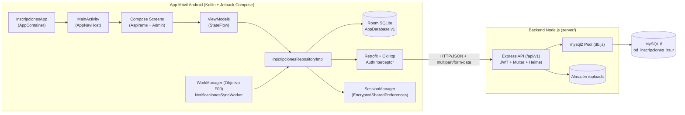

# Especificación Técnica Consolidada y Plan de Implementación — Sistema de Inscripciones ITSUR (Nuevo Ingreso)

**Proyecto:** Sistema de Inscripciones de Nuevo Ingreso ITSUR  
**Materia:** Programación Móvil I · 7° Semestre  
**Equipo:** Montserrat Tenorio Villagómez · Alan Yael Fonseca Ruiz · Dafne Guadalupe Orozco Aguirre  
**Rama de referencia:** `feature/correcciones2doEntregable`  
**Última actualización:** 2026-11-24  
**Estado del documento:** Fuente de verdad única en `SPECS/` (reemplaza los documentos desfasados `01..04` y `ARQUITECTURA_Y_REQUERIMIENTOS_E2.md`)

> [!IMPORTANT]
> **Alcance de esta entrega documental:** En esta iteración únicamente se consolida el documento de especificación y plan de implementación en `SPECS/` y se retiran los archivos anteriores desfasados de dicha carpeta. **No se modifica código fuente de Android, Backend Node.js ni esquema MySQL en esta entrega**; la implementación técnica se ejecutará de forma incremental en las Fases 3 a 7 definidas en este documento.

---

## 1. Estado Real Actual del Proyecto (Auditoría del Código)

El repositorio está compuesto por una aplicación nativa **Android (Kotlin + Jetpack Compose)**, una **API REST en Node.js / Express** y un esquema **MySQL 8 (`bd_inscripciones_itsur`)**.

### 1.1 Stack Técnico Real Verificado
| Capa | Implementación Actual en el Repositorio |
| :--- | :--- |
| **Android UI** | Jetpack Compose + Material 3 (`compileSdk 37`, `minSdk 29`, `targetSdk 37`), `Navigation Compose`, paleta azul-gris institucional (`#1E3A5F`, `#ACD0F2`, `#A7C7E4`, `#F4F7FB`). |
| **Estado y DI** | `ViewModel` + `StateFlow` con fábrica manual (`AppViewModelProvider`) y contenedor `AppContainer`. |
| **Persistencia Local** | Room (`AppDatabase` v1, 9 entidades y 7 DAOs) + `SessionManager` (`EncryptedSharedPreferences`). |
| **Red** | Retrofit 2 + Gson + OkHttp 3 (`AuthInterceptor` + `HttpLoggingInterceptor`). |
| **Backend API** | Node.js + Express (`server/src/app.js`, `db.js`, `server.js`) con `mysql2`, `bcrypt`, `multer`, `helmet`, `cors`, `compression`, `jsonwebtoken` y `zod` instalados en `package.json`. |
| **Base de Datos** | MySQL 8 InnoDB (`server/database/schema.sql`) con inicialización automática de semillas en `server/src/db.js`. |

### 1.2 Inventario Real de Pantallas y Estado Actual
*(Nota: `CredentialPhotoScreen` y `ReglamentoScreen` ya fueron retiradas del flujo activo de `AppNavHost.kt` y `HomeScreen.kt`.)*

| Módulo | Pantalla / ViewModel | Estado Real Actual | Brechas Detectadas a Resolver |
| :--- | :--- | :--- | :--- |
| **Autenticación** | `LoginScreen` / `LoginViewModel` | Operativo parcial | Contiene botones `Demo Alumno` y `Demo Escolar`, ícono genérico `Icons.Default.School` (sin logo ITSUR), sin Splash Screen; `InscripcionesRepositoryImpl.login()` cae en `loginDemo()` ante `IOException`. |
| **Registro** | `RegisterScreen` / `RegisterViewModel` | Operativo parcial | Usa lista fija `municipiosGto` (solo Guanajuato), `carrerasItsur` hardcodeada en ViewModel, contraseña mínimo 6 caracteres, `estado` y `municipio` precargados (`"Guanajuato"` / `"Uriangato"`). |
| **Menú Alumno** | `HomeScreen` / `HomeViewModel` | Operativo parcial | Conserva tarjeta de **Comprobante de Pago**, tiene botón de **Cerrar Sesión duplicado** (TopBar + botón inferior) y `AppNavHost.logout` no invoca `repository.logout()`, carece de acceso a **Preguntas y Dudas**, muestra fallback de folio `"ITSUR-2026-0042"` y subtítulo de documentos menciona solo 3 de 4. |
| **Documentos** | `DocumentsScreen` / `DocumentsViewModel` | Operativo parcial | Simula tamaño fijo `2MB` (`1024 * 1024 * 2`) y fallback `"2.1 MB"`, `TipoDocumento` conserva `COMPROBANTE_PAGO`, guarda URI `content://` sin copiar a archivo local ni calcular SHA-256 real ni subir por `@Multipart`. |
| **Estatus** | `StatusScreen` / `StatusViewModel` | Operativo parcial | Stepper de 5 pasos incluye `"4. Pago de Inscripción Acreditado"` y `"5. Inscripción Concluida"`; depende de `repository.getComprobantePago()`. |
| **Perfil** | `ProfileScreen` / `ProfileViewModel` | Operativo parcial | Edita un solo campo combinado `"Dirección / Municipio"` (sin `Estado` y `Municipio` separados); `cambiarPassword()` exige mínimo 6 caracteres y simula éxito sin llamar a la API. |
| **Notificaciones** | `NotificationsScreen` / `NotificationsViewModel` | Operativo parcial | Solo notificaciones en bandeja in-app; sin notificaciones del sistema Android (`NotificationCompat` / `WorkManager`); datos del backend siguen en memoria. |
| **Pago (Obsoleto)** | `PaymentScreen` / `PaymentViewModel` | **A eliminar (Req 14)** | Debe eliminarse junto con sus entidades, DAOs, DTOs, rutas, endpoints y tabla `pagos` (más restos `reglamentoFirmado` en repositorio). |
| **Panel Admin** | `AdminHomeScreen` / `AdminHomeViewModel` | Operativo parcial | Tiene botón y diálogo de **"Revisión Rápida"** (usa `"doc_1"` hardcodeado), botón de **Logout** en esquina superior derecha, `TextButton("Fechas Límite")` pequeño sin Navigation Drawer, contadores no clickeables y sin `En Captura` ni `Con Observaciones`, búsqueda sin CURP y sin recarga al volver del detalle. |
| **Expediente Admin** | `AdminAspiranteDetailScreen` / `ViewModel` | Operativo parcial | No previsualiza PDFs, carga `repository.getDocumentos()` en vez de los documentos del `aspiranteId`, habilita Aprobar/Rechazar incluso en documentos no subidos, permite aprobar trámite sin validar los 4 documentos e incluye botón **"Rechazar Trámite"**. |
| **Fechas Admin** | `AdminFechasScreen` / `AdminFechasViewModel` | Operativo parcial | Solo agrega en memoria local (sin API ni Editar/Eliminar), pide `diasRestantes` manual y usa `FloatingActionButton` flotante sobre la lista. |

### 1.3 Brechas Críticas Detectadas en Backend, BD, Contratos DTO y Tema
1. **Hardcodes y persistencia incompleta en `server/src/app.js`:** Existe un objeto `db` en memoria con arreglos ficticios (`aspirantes`, `documentos`, `notificaciones`, `fechasImportantes`, `pagoActual`). Aunque `auth/register`, `auth/login`, `catalogos/*` y `admin/aspirantes` consultan MySQL, los módulos de **documentos, revisiones, notificaciones y fechas** operan en memoria. Además, `getAspirante*` usa `COALESCE(e.nombre, 'Guanajuato')` / `COALESCE(m.nombre, 'Uriangato')` y `recalcularEstadoAspirante()` solo revisa 3 documentos y auto-aprueba el trámite.
2. **Autenticación simulada en `server/src/app.js`:** `jsonwebtoken` está instalado pero no se usa; los tokens son strings planos (`jwt-access-...`), existen contraseñas backdoor (`admin123`, `itsur2026`, `123456`), no hay middleware JWT para identificar a `req.user`, y endpoints `/aspirantes/me/*` operan sobre `idAspirante = 1` o el último aspirante registrado (`ORDER BY id_aspirante DESC LIMIT 1`).
3. **Desajustes críticos de contratos DTO/API y mappers en Android:**
   - `AspiranteDto` carece de `nombreCompleto` y `correo`, provocando que `mapDtoToAspirante()` (`InscripcionesRepositoryImpl.kt`) asigne `nombreCompleto = dto.folio` y `email = ""`.
   - `mapDtoToAspirante()` y `mapEntityToAspirante()` llaman `EstadoInscripcion.valueOf(...)` directamente sobre los valores `snake_case` de MySQL (`en_captura`, `en_revision`, `con_observaciones`, `documentacion_aprobada`), colapsando todos los registros en `EN_REVISION`; además `mapEntityToAspirante()` hardcodea `carrera = "Ingeniería en Sistemas Computacionales"`.
   - Mismatches de campos JSON: `DocumentoItemDto` espera `nombreOriginal` (el servidor envía `nombreArchivo`), `SubirDocumentoResponseDto` espera `success: Boolean` (el servidor no lo envía), `RevisionDto` envía `estado` (el servidor lee `resultado`), `NotificacionItemDto` espera `fechaEnvio` (el servidor envía `fecha`), `InscripcionesApiService.getMiResumen()` espera `AspiranteDto` (el servidor devuelve resumen anidado) y `revisarDocumento()` espera `DocumentoItemDto` (el servidor devuelve objeto de revisión).
   - `InscripcionesRepositoryImpl.kt` mantiene listas demo (`currentAspirante`, `documentosList`, `notificacionesList`, `fechasList`, `comprobantePago`, `aspirantesAdminList`), `loginDemo()` en `IOException`, mapeo `when` hardcodeado de carreras con `idEstado = 11, idMunicipio = 1` y restos de `reglamentoFirmado`; `Aspirante.kt` conserva datos ficticios por defecto.
   - `RetrofitClient.kt` usa `HttpLoggingInterceptor.Level.BODY`, lo cual debe cambiarse a `Level.HEADERS` (o excluir respuestas binarias) para no causar OOM al descargar PDFs con `@Streaming`.
4. **Tema y contraste (`Theme.kt`, `Color.kt` y pantallas):** `AppTheme` usa `isSystemInDarkTheme()` por defecto y los textos secundarios/títulos usan grises (`#85898C`, `ItsurOutline`, `Color(0xFF757575)` en `StatusScreen`, `Color(0xFF616161)` en `StatusChip`) o azul pizarra (`#112233`) en lugar de negro (`#000000`) sobre fondos claros.
5. **Tablas y catálogos obsoletos en `schema.sql` / `db.js`:** Permanecen las tablas `pagos` y `firmas_reglamento`, las semillas de `estados`/`municipios` con IDs fijos en `db.js`, y faltan columnas de residencia libre en `aspirantes` y la tabla `preguntas_dudas`.

---

## 2. Decisiones Confirmadas en Sesión de Aclaración (`/grill-me`)

Todas las decisiones siguientes son vinculantes para la especificación y la implementación posterior:

1. **Alcance de la entrega actual:** Únicamente crear este documento consolidado en `SPECS/` y eliminar los archivos anteriores desfasados; no modificar código Android, Backend ni BD todavía.
2. **Limpieza de `SPECS/`:** Eliminar los archivos desfasados (`01_diagrama_base_datos_relacional.md`, `02_diagrama_uml_paquetes.md`, `03_diagrama_uml_componentes.md`, `04_diagrama_uml_despliegue.md` y `ARQUITECTURA_Y_REQUERIMIENTOS_E2.md`) dejando este archivo como fuente de verdad única.
3. **Color de letras negro y modo claro (Req 2):** Forzar modo claro institucional en `AppTheme`, cambiar el color de todas las letras sobre fondos claros, inputs y tarjetas a **negro (`#000000`)**, y conservar texto **blanco (`#FFFFFF`)** únicamente sobre fondos oscuros (`#1E3A5F` y botones/badges oscuros).
4. **Previsualización de documentos por Admin (Req 4):** Visor PDF integrado dentro de la app usando `PdfRenderer` (navegación por páginas y zoom) + botón secundario para abrir el PDF en app externa mediante `FileProvider`.
5. **Regla de aprobación de trámite (Req 5):** Exigir aprobados los **4 documentos obligatorios** definidos en BD (`Acta de Nacimiento`, `CURP`, `Certificado de Bachillerato` y `Comprobante de Domicilio`) antes de habilitar `"Aprobar Trámite"`, validado tanto en UI como en el Backend/MySQL.
6. **Navigation Drawer y Logout (Reqs 8 y 16):** Implementar Navigation Drawer **solo para el Administrador** (`Panel`, `Fechas Límite`, `Preguntas y Dudas`, `Aviso General` y `Cerrar Sesión`), retirando el botón de Logout de la esquina superior derecha. En el Menú Principal del Alumno eliminar el botón de Cerrar Sesión duplicado dejando solo uno.
7. **Contadores filtrables del Panel Escolar (Req 10):** Mantener los 3 contadores existentes (`Total`, `En Revisión`, `Aprobados`) como filtros clickeables y agregar `En Captura` y `Con Observaciones` para cubrir todos los estados reales de la BD.
8. **Estado y Municipio separados (Req 11):** Eliminar la lista fija de municipios y separar `Estado` y `Municipio` en campos de texto libre tanto en **Registro (`RegisterScreen`)** como en **Mi Perfil (`ProfileScreen`)**.
9. **Eliminación total de pagos (Req 14):** Eliminar comprobante de pago de toda la app Android, de la API Node.js y quitar las tablas obsoletas (`pagos` y `firmas_reglamento`) de `server/database/schema.sql`.
10. **Notificaciones en dispositivo Android sin Firebase (Reqs 15 y 16):** Usar `WorkManager` periódico en segundo plano + verificación inmediata al sincronizar en la app, mostrando alertas del sistema con `NotificationCompat` y permiso `POST_NOTIFICATIONS` (Android 13+).
11. **Logo oficial del ITSUR (Req 19):** Integrar el logo oficial adjunto por el usuario (`media_1795565098639_56f2bbca.jpg`) en `LoginScreen` (reemplazando el ícono genérico), en el **Splash Screen inicial** y como **ícono launcher** de la aplicación.

---

## 3. Recapitulación de Features Base Vigentes (Fases 0 a 2)

Se conservan y resumen únicamente las capacidades vigentes del proyecto base:

| Fase | ID | Feature Vigente | Funcionalidad Consolidada | Estado Actual |
| :---: | :---: | :--- | :--- | :---: |
| **Fase 0** | **F00** | Fundaciones y Arquitectura | Contenedor DI (`AppContainer`), Room (`AppDatabase`), Retrofit + OkHttp (`AuthInterceptor`), `SessionManager`, servidor Node.js/Express + MySQL 8 (`db.js`, `schema.sql`), paleta azul-gris institucional y manejo de teclado IME (`BringIntoViewRequester` + `imePadding`). | Base operativa (requiere endurecimiento en F07) |
| **Fase 1** | **F01** | Autenticación y Registro | Login unificado por correo/usuario con enrutamiento por rol (`aspirante` / `escolar`) y registro transaccional con validación de CURP, correo y generación de folio `ITSUR-2026-XXXXX`. | Base operativa (ajustes en F07) |
| **Fase 1** | **F02** | Menú Principal y Estatus | Dashboard del aspirante con bienvenida, folio, estatus general, avance de documentos y pantalla de línea de tiempo del trámite. *(Retirados: Foto Credencial, Reglamento y Pago).* | Base operativa (ajustes en F07) |
| **Fase 1** | **F03** | Carga de Documentos PDF | Gestión de los 4 documentos obligatorios (`Acta de Nacimiento`, `CURP`, `Certificado de Bachillerato`, `Comprobante de Domicilio`) en formato PDF hasta 5 MB con versionado e integridad SHA-256. | Parcial (persistencia MySQL y lectura real en F07) |
| **Fase 1** | **F04** | Perfil / Datos Personales | Consulta de datos oficiales y edición de contacto, residencia y contraseña del aspirante. | Parcial (campos separados y API password en F07) |
| **Fase 1** | **F05** | Notificaciones y Fechas Límite | Bandeja de avisos de Control Escolar con filtro de no leídas, marcado de lectura y calendario de fechas límite con días restantes. | Parcial (persistencia MySQL + `WorkManager` en F07/F09) |
| **Fase 2** | **F06** | Panel Base de Control Escolar | Listado de aspirantes con buscador, vista de expediente individual con dictamen por documento y pantalla de fechas límite. | Parcial (rediseño completo en F08 y F09) |

---

## 4. Plan de Fases de Implementación (Fases 3 a 7)

Las **3 nuevas features (`F07`, `F08`, `F09`)** se ejecutarán de forma ordenada en cinco fases técnicas para evitar regresiones:

| Fase | Nombre de la Fase | Features / Tareas Involucradas | Resultado Esperado |
| :---: | :--- | :--- | :--- |
| **Fase 3** | **BD, Seguridad JWT, Limpieza de Pagos y Persistencia Real API** | `F07-07` (BD/API), `F07-09` (Backend), `F08-04` (API PDF), `F08-05` (API Aprobar), `F08-07` (API CRUD Fechas), `F09-01`, `F09-02` | Esquema MySQL limpio (sin `pagos`/`firmas_reglamento`, con residencia libre y `preguntas_dudas`), API REST 100% persistente en MySQL con JWT real y cero datos hardcodeados en memoria. |
| **Fase 4** | **Branding ITSUR, Tema Claro/Negro y Depuración del Flujo Alumno** | `F07-01`, `F07-02`, `F07-03`, `F07-04`, `F07-05`, `F07-06`, `F07-07` (Android), `F07-08`, `F07-09` (Android) | App en modo claro con tipografía negra `#000000`, logo ITSUR en Splash/Login/Launcher, sin demos ni pagos, registro/perfil con Estado y Municipio separados, contraseña mín. 8 caracteres, línea de tiempo de 4 pasos y repositorio Android conectado a API real. |
| **Fase 5** | **Rediseño del Panel Administrativo, Drawer, Visor PDF y CRUD Fechas** | `F08-01`, `F08-02`, `F08-03`, `F08-04` (Android), `F08-05` (Android), `F08-06`, `F08-07` (Android) | Admin con Navigation Drawer exclusivo (sin logout en esquina superior), sin Revisión Rápida ni Rechazar Trámite, 5 contadores clickeables de estado, visor PDF integrado (`PdfRenderer` + `FileProvider`), bloqueo de aprobación hasta tener 4/4 documentos aprobados y CRUD completo de Fechas. |
| **Fase 6** | **Preguntas y Dudas Bidireccional, Aviso General y Notificaciones Android** | `F09-03`, `F09-04`, `F09-05`, `F09-06`, `F09-07` | Módulo de Preguntas y Dudas en Alumno (`Fechas`/`Documentos`) y Admin (quién, cuándo, filtros combinados `Tipo × Estado` y respuesta), Aviso General masivo desde Drawer Admin, y alertas reales en dispositivo Android vía `WorkManager` + `NotificationCompat`. |
| **Fase 7** | **Integración End-to-End, Pruebas y Verificación Final** | Validación cruzada de F07, F08 y F09 | Compilación limpia (`assembleDebug`), pruebas unitarias/API, verificación manual en emulador/dispositivo físico con backend MySQL real y cierre de checklist de los 19 requerimientos. |

---

## 5. Especificación Detallada de las 3 Nuevas Features

---

### Feature Nueva 1 (`F07`): Identidad Institucional ITSUR, Limpieza de Hardcodes/Pagos y Conexión Real API/BD

**Objetivo:** Consolidar la calidad de producción de la app y del backend eliminando botones de demostración, datos hardcodeados y todo rastro del módulo de pagos; incorporar el logo oficial del ITSUR; forzar modo claro con texto negro de alto contraste; y alinear registro, perfil, contraseñas y línea de tiempo con la persistencia real en MySQL.  
**Requerimientos cubiertos:** `#1, #2, #3, #11, #12, #13, #14, #18, #19`

#### Tasks de `F07`

- [x] **F07-01 — Eliminar botones de demo y backdoors de autenticación (Req 1, Req 3)**
  - Retirar los botones `"Demo Alumno"` y `"Demo Escolar"` de `LoginScreen.kt` y los parámetros `onDemoAspirante` / `onDemoEscolar` de `LoginContent`.
  - Eliminar `setDemoAspirante()` y `setDemoEscolar()` de `LoginViewModel.kt`.
  - Eliminar el método `loginDemo()` y el fallback silencioso en `IOException` de `InscripcionesRepositoryImpl.kt` para que cualquier error de red o credenciales se propague de forma real al usuario.
  - Eliminar en `server/src/app.js` la validación backdoor (`contrasena === 'admin123' || 'itsur2026' || '123456'`) y el fallback que autentica usuarios inexistentes cuando falla la consulta MySQL.

- [x] **F07-02 — Forzar modo claro institucional y cambiar texto a negro `#000000` (Req 2)**
  - Modificar `Theme.kt` para fijar `darkTheme: Boolean = false` y `dynamicColor: Boolean = false` (ignorando `isSystemInDarkTheme()`), evitando inversiones indeseadas en dispositivos con tema oscuro.
  - Actualizar `Color.kt` (`ItsurOnSurface`, `ItsurVinoOscuro`, `ItsurOnSurfaceVariant`, `onBackgroundLight`, `onSurfaceLight`, `onSurfaceVariantLight`, `onPrimaryContainerLight`, `onSecondaryContainerLight`) a negro puro `Color(0xFF000000)` para todos los textos sobre fondos claros, tarjetas blancas/azules pastel e inputs.
  - Ajustar `ItsurComponents.kt` (`ItsurTextField`, `OptionCard`, `EmptyState`, `StatusChip` — reemplazando `Color(0xFF616161)`) y todas las pantallas Compose (incluyendo `Color(0xFF757575)` en `StatusScreen.kt` y textos con `ItsurOutline` en `NotificationsScreen.kt` y `AdminFechasScreen.kt`) para asegurar `focusedTextColor = Color.Black`, `unfocusedTextColor = Color.Black`, textos/etiquetas en `#000000` sobre fondos claros, conservando `Color.White` únicamente sobre fondos oscuros (`ItsurCiruela #1E3A5F`, botones primarios/semánticos oscuros y badges oscuros).

- [x] **F07-03 — Integrar logo oficial del ITSUR en Splash, Login e ícono launcher (Req 19)**
  - Procesar la imagen oficial proporcionada (`Logo_Itsur.png`, proporcionada durante F07 en `266×218 px`): incorporarla como drawable `app/src/main/res/drawable/logo_itsur.png` (o `.jpg` optimizado) y generar además una versión centrada sobre lienzo cuadrado `1:1` con margen de seguridad (`~22%` de padding) para evitar recortes en el círculo seguro (`66×66 dp` dentro de `108×108 dp`) del Adaptive Icon y del Splash Screen de Android 12+.
  - Reemplazar `Icons.Default.School` en `LoginScreen.kt` por `Image(painter = painterResource(R.drawable.logo_itsur), contentScale = ContentScale.Fit, ...)` dentro del encabezado institucional.
  - Configurar Splash Screen inicial usando `androidx.core:core-splashscreen` en `gradle/libs.versions.toml`, `app/build.gradle.kts`, `res/values/themes.xml` (`Theme.App.Starting`) e invocación `installSplashScreen()` en `MainActivity.kt` mostrando el logo oficial del ITSUR al arrancar la app.
  - Actualizar los recursos adaptativos del ícono launcher (`mipmap-*/ic_launcher*` e `ic_launcher_foreground`) con el logo del ITSUR centrado en zona segura.

- [x] **F07-04 — Separar Estado y Municipio en campos de texto libre en Registro y Mi Perfil (Req 11)**
  - **Registro (`RegisterScreen.kt` / `RegisterViewModel.kt`):** Eliminar la lista hardcodeada `municipiosGto`, el `ExposedDropdownMenuBox` de municipio y los valores precargados `estado = "Guanajuato"` / `municipio = "Uriangato"` en `RegisterUiState`; reemplazar por dos `ItsurTextField` independientes y obligatorios: `"Estado de Residencia"` y `"Municipio de Residencia"` (inicializados en `""`, con `onEstadoChange`, `onMunicipioChange`, `errorEstado` y `errorMunicipio`).
  - **Perfil (`ProfileScreen.kt` / `ProfileViewModel.kt`):** Separar el campo de residencia en `Dirección (calle y colonia)`, `Municipio` y `Estado` tanto en modo lectura (`DatoItem`) como en modo edición (`ItsurTextField`), mostrando también estos datos en `AdminAspiranteDetailScreen.kt`.
  - **Modelo, Room, API y BD:** Agregar `estadoResidencia: String` y `municipioResidencia: String` en `Aspirante`, `AspiranteEntity`, `RegisterRequestDto` y `AspiranteDto`; retirar la dependencia de `idEstado = 11` / `idMunicipio = 1` en `InscripcionesRepositoryImpl.kt`, los `COALESCE(..., 'Guanajuato'/'Uriangato')` de `server/src/app.js`, los endpoints obsoletos `GET /catalogos/estados` y `GET /catalogos/municipios` (junto con `EstadoEntity`/`MunicipioEntity`), y actualizar `server/database/schema.sql` + `server/src/db.js` añadiendo `estado_residencia VARCHAR(100) NULL` y `municipio_residencia VARCHAR(120) NULL` en `aspirantes` (dejando `id_estado`/`id_municipio` opcionales o retirando dichas FKs y semillas fijas).

- [x] **F07-05 — Regla de contraseña mínimo 8 caracteres en App y API (Req 12, Req 18)**
  - Actualizar etiqueta y validación en `RegisterScreen.kt` / `RegisterViewModel.kt` a `contrasena.length < 8` (`"La contraseña debe tener mínimo 8 caracteres"`).
  - Actualizar etiqueta y validación en `ProfileScreen.kt` / `ProfileViewModel.kt` a mínimo 8 caracteres y conectar `cambiarPassword()` con el nuevo endpoint real `PATCH /api/v1/auth/password` (validando contraseña actual con `bcrypt` en servidor).
  - Aplicar validación estricta de mínimo 8 caracteres en `POST /api/v1/auth/register` y `PATCH /api/v1/auth/password` dentro de `server/src/app.js`.

- [x] **F07-06 — Actualizar línea de tiempo en Estatus de Inscripción (Req 13)**
  - En `StatusScreen.kt`, eliminar el paso `"4. Pago de Inscripción Acreditado"` y reemplazar el antiguo paso 5 por `"4. Documentos aprobados"`, dejando la línea de tiempo con 4 etapas:
    1. `1. Registro de Aspirante`
    2. `2. Carga de Documentos`
    3. `3. Cotejo y Revisión Escolar`
    4. `4. Documentos aprobados`
  - En `StatusViewModel.kt`, eliminar toda llamada a `repository.getComprobantePago()` y calcular `etapaActual` exclusivamente con base en el estado real del aspirante y de los 4 documentos obligatorios (`etapaActual = 4` cuando `estadoInscripcion == ACEPTADO`, es decir, `'documentacion_aprobada'` dictaminada por Control Escolar tras aprobar 4/4 documentos).
  - En `HomeScreen.kt`, actualizar la descripción de la tarjeta `"Carga de Documentos"` para reflejar los **4 documentos obligatorios** (`Acta, CURP, Certificado y Comprobante de Domicilio`).

- [x] **F07-07 — Eliminar completamente Comprobante de Pago y tablas/restos obsoletos (Req 14)**
  - **Android:** Eliminar `PaymentScreen.kt`, `PaymentViewModel.kt`, `ComprobantePago.kt`, `ComprobantePagoEntity.kt`, `ComprobantePagoDao.kt`, `PagoDto.kt`; remover `Screen.Payment`, `Screen.CredentialPhoto` y `Screen.Reglamento` de `Screen.kt`; quitar la tarjeta `"Comprobante de Pago"` y callback `onNavigateToPayment` de `HomeScreen.kt` y `AppNavHost.kt`; eliminar `TipoDocumento.COMPROBANTE_PAGO` de `Documento.kt`; retirar los restos `reglamentoFirmado`, `isReglamentoFirmado()` y `firmarReglamento()` de `InscripcionesRepository.kt` e `InscripcionesRepositoryImpl.kt`; limpiar referencias en `AppDatabase.kt`, `AppContainer.kt`, `AppViewModelProvider.kt` e `InscripcionesApiService.kt`.
  - **Backend (`server/src/app.js`):** Eliminar `db.pagoActual`, rutas `GET /api/v1/aspirantes/me/pago` y `POST /api/v1/aspirantes/me/pago`, y la fecha de ejemplo de pago.
  - **Base de Datos (`server/database/schema.sql`):** Eliminar las tablas `pagos` y `firmas_reglamento`, y retirar `'pago'` del `ENUM` de `notificaciones.tipo`.

- [x] **F07-08 — Eliminar botón de Cerrar Sesión duplicado en Menú Principal del Alumno y conectar logout real (Req 8 — complemento)**
  - En `HomeScreen.kt`, conservar **un único** botón/acción de cierre de sesión (el ícono en `ItsurTopBar` o el botón inferior, retirando el duplicado).
  - Corregir el callback `logout` en `AppNavHost.kt` (actualmente solo navega a `Screen.Login`) para que ejecute `repository.logout()` (revocando refresh token en API, limpiando `SessionManager`, purgando todas las tablas Room — incluida `preguntas_dudas` — y cancelando trabajos `WorkManager` del usuario anterior) antes de navegar a `LoginScreen`.

- [x] **F07-09 — Eliminar todas las partes hardcodeadas, alinear contratos DTO y conectar procesos con API + MySQL (Req 3, Req 18)**
  - **Backend (`server/src/app.js` y `db.js`):**
    - Implementar firma y verificación real de JWT (`jsonwebtoken`) con `accessToken` + `refreshToken` almacenado con hash SHA-256 en la tabla `refresh_tokens`.
    - Crear middlewares `requireAuth` (extrae `req.user = { idUsuario, rol, idAspirante }`) y `requireRole('escolar')`.
    - Eliminar por completo el objeto `const db = { ... }` en memoria y todos los fallbacks mock.
    - Migrar a SQL real (`pool.query` / transacciones) todos los endpoints: `GET/PUT /aspirantes/me`, `GET /aspirantes/me/resumen`, `GET/POST /aspirantes/me/documentos`, `DELETE /documentos/:id`, `GET/PATCH/DELETE /notificaciones/*` (incluido `PATCH /notificaciones/leer-todas`), `GET /fechas-importantes`, `GET /admin/aspirantes/:id/documentos`, `POST /admin/documentos/:id/revision`.
    - Corregir `recalcularEstadoAspirante(idAspirante)` en SQL para evaluar los **4 documentos obligatorios** (`ACTA_NACIMIENTO`, `CURP`, `CERTIFICADO_BACHILLERATO`, `COMPROBANTE_DOMICILIO`) siguiendo esta máquina de estados coherente con `F08-05`: si alguno tiene rechazo/observación -> `'con_observaciones'`; si faltan archivos por subir (`< 4`) -> `'en_captura'`; si los 4 están subidos (incluso cuando los 4 ya estén en `'aprobado'`) -> mantener `'en_revision'` hasta que Control Escolar confirme explícitamente `"Aprobar Trámite"` vía `POST /api/v1/admin/aspirantes/:id/aprobar`, único punto que transiciona a `'documentacion_aprobada'` (Req 5).
    - Asegurar que `/aspirantes/me/*` use siempre `req.user.idAspirante` (eliminando `ORDER BY id_aspirante DESC LIMIT 1` y `asp1_`).
  - **Android (Contratos DTO, Mappers y Limpieza de Hardcodes):**
    - Alinear estrictamente los DTOs y respuestas JSON con el backend:
      - `AspiranteDto`: añadir `nombreCompleto`, `correo`, `estadoResidencia`, `municipioResidencia` y corregir `mapDtoToAspirante()` (dejar de usar `dto.folio` como nombre y `email = ""`).
      - Mapear explícitamente los valores `snake_case` de MySQL (`en_captura` -> `PENDIENTE`, `en_revision` -> `EN_REVISION`, `con_observaciones` -> `CON_OBSERVACIONES`, `documentacion_aprobada` -> `ACEPTADO`) en `mapDtoToAspirante()` y `mapEntityToAspirante()` (y resolver `carrera` real desde catálogo/DTO en lugar de hardcodear `"Ingeniería en Sistemas Computacionales"`).
      - Alinear `DocumentoItemDto` (`nombreArchivo`/`nombreOriginal`), `SubirDocumentoResponseDto` (`success`/payload real), `RevisionDto` (`resultado` en lugar de `estado` + DTO de respuesta de revisión), `NotificacionItemDto` (`fechaEnvio`/`fecha`), y `ResumenAspiranteDto` para `GET /aspirantes/me/resumen`.
      - Eliminar `GET("auth/me")` no implementado (o implementarlo en servidor si se requiere validación de sesión al arranque) y agregar `@Query` faltantes en `getAdminAspirantes(estado, q)` y `getNotificaciones(leida, afterId)`.
    - Eliminar las listas y objetos hardcodeados de `InscripcionesRepositoryImpl.kt` (`currentAspirante`, `documentosList`, `notificacionesList`, `fechasList`, `comprobantePago`, `aspirantesAdminList`), la lista hardcodeada `carrerasItsur` de `RegisterViewModel.kt` (cargarla desde `GET /api/v1/catalogos/carreras` + `CatalogosDao`) y el bloque `when` de `idCarrera`, así como los valores por defecto ficticios en `Aspirante.kt`, `"ITSUR-2026-0042"` en `HomeScreen.kt` y `"2.1 MB"` en `DocumentsScreen.kt`.
    - En `DocumentsScreen.kt` / `DocumentsViewModel.kt` / `InscripcionesRepositoryImpl.kt`, consultar nombre y tamaño real del PDF vía `ContentResolver` (`OpenableColumns`), validar tamaño real `<= 5 MB`, copiar el contenido de la `Uri` a almacenamiento interno (`filesDir/docs/`), calcular `SHA-256` real con `FileHashHelper` y enviarlo por `@Multipart` (`@Part("hashSha256")`) a `POST /api/v1/aspirantes/me/documentos`.
    - Externalizar `BASE_URL` en `app/build.gradle.kts` (`buildConfigField`) en lugar de hardcodear `127.0.0.1` en `RetrofitClient.kt`, y propagar errores reales de red/servidor a la UI.

---

### Feature Nueva 2 (`F08`): Rediseño del Panel Administrativo, Navigation Drawer, Visor de Documentos y CRUD de Fechas

**Objetivo:** Profesionalizar la experiencia del personal de Control Escolar centralizando la navegación administrativa en un Navigation Drawer, eliminando atajos peligrosos (`Revisión Rápida` y `Rechazar Trámite`), habilitando filtrado interactivo por estado desde los contadores, incorporando previsualización real de PDFs de cada aspirante, haciendo cumplir la regla de 4/4 documentos aprobados y habilitando el CRUD completo de Fechas Límite.  
**Requerimientos cubiertos:** `#4, #5, #6, #7, #8, #9, #10, #18`

#### Tasks de `F08`

- [ ] **F08-01 — Navigation Drawer exclusivo para Administrador y retiro de Logout de esquina superior derecha (Req 8, Req 16)**
  - Crear componente/contenedor administrativo con `ModalNavigationDrawer` y `ModalDrawerSheet` exclusivo para el rol `escolar` (manteniendo sin Drawer al Alumno).
  - Actualizar `ItsurTopBar` para aceptar un parámetro opcional `onOpenDrawer: (() -> Unit)? = null` que renderice el ícono hamburguesa (`Icons.Default.Menu`) a la izquierda y **no mostrar** `onLogout` en la esquina superior derecha de las pantallas administrativas.
  - Poblar el `ModalDrawerSheet` con cabecera institucional ITSUR (logo + rol Control Escolar) y 5 destinos grandes y claros:
    1. `Panel de Control` (`Screen.AdminHome`)
    2. `Fechas Límite` (`Screen.AdminFechas`)
    3. `Preguntas y Dudas` (`Screen.AdminQuestions`)
    4. `Aviso General` (`Screen.AdminBroadcast`)
    5. `Cerrar Sesión` (ejecuta `logout()` limpiando tokens y Room)
  - Retirar el botón pequeño `TextButton("Fechas Límite")` de la fila de encabezado en `AdminHomeScreen.kt`.

- [ ] **F08-02 — Eliminar botón y zona de Revisión Rápida en Panel de Control Escolar (Req 7)**
  - Eliminar el botón `"Revisión Rápida"` de las tarjetas de aspirante en `AdminHomeScreen.kt`, dejando únicamente `"Ver Expediente"` a ancho completo (o acción clara de apertura del expediente).
  - Eliminar el `AlertDialog` de revisión rápida en `AdminHomeScreen.kt`.
  - Limpiar de `AdminHomeUiState` y `AdminHomeViewModel.kt` las propiedades/métodos `aspiranteSeleccionadoParaRevision`, `observacionesInput`, `abrirDialogoRevision()`, `cerrarDialogoRevision()`, `onObservacionesChange()` y `resolverRevision()` (que además tenía `"doc_1"` hardcodeado).

- [ ] **F08-03 — Filtrado interactivo de alumnos mediante contadores de estado en Panel Escolar (Req 10)**
  - Mantener las tarjetas contadoras de `AdminHomeScreen.kt` (`Total`, `En Revisión`, `Aprobados`) haciéndolas clickeables con borde/resaltado activo cuando el filtro esté seleccionado, y añadir `En Captura` (`PENDIENTE` / `en_captura`) y `Con Observaciones` (`CON_OBSERVACIONES` / `con_observaciones`) en `LazyRow` o grid compacto de 2 filas para cubrir los 4 estados reales activos + `Total`.
  - Agregar `estadoFiltroSeleccionado: EstadoInscripcion? = null` en `AdminHomeUiState` y `onFiltroEstadoChange(estado: EstadoInscripcion?)` en `AdminHomeViewModel.kt`.
  - Combinar el filtro de estado seleccionado con la búsqueda por texto (**nombre, folio y CURP**) en tiempo real, recargar la lista al volver del expediente (`LaunchedEffect(Unit) { viewModel.cargarAspirantes() }`) y sincronizar con `GET /api/v1/admin/aspirantes?estado=...&q=...` y pull-to-refresh.

- [ ] **F08-04 — Previsualización y visualización de documentos cargados por alumno en Expediente (Req 4, Req 18)**
  - **Backend:**
    - Implementar `GET /api/v1/admin/aspirantes/:id/documentos` consultando MySQL para retornar los 4 tipos de documento del `id_aspirante` solicitado (indicando cuál ya fue subido, su `idDocumento`, nombre, tamaño, versión, estado y observaciones).
    - Implementar `GET /api/v1/admin/documentos/:id/archivo` protegido con JWT + rol `escolar`, validando existencia del archivo en `/uploads` (previniendo path traversal) y enviándolo con `Content-Type: application/pdf`.
  - **Android:**
    - Corregir `AdminAspiranteDetailViewModel.cargarDetalle(aspiranteId)` para consumir `repository.getDocumentosDeAspirante(aspiranteId)` en lugar de `repository.getDocumentos()`.
    - Ajustar `HttpLoggingInterceptor` en `RetrofitClient.kt` de `Level.BODY` a `Level.HEADERS` (o excluir endpoints binarios) para evitar `OutOfMemoryError` y preservar el streaming real al descargar PDFs.
    - Agregar en `InscripcionesApiService` el endpoint `@Streaming @GET("admin/documentos/{id}/archivo") suspend fun descargarArchivoDocumento(@Path("id") id: Long): Response<ResponseBody>` y método en repositorio para guardar temporalmente el PDF en `context.cacheDir/preview_docs/`.
    - Añadir en cada tarjeta de documento **cargado** (`nombreArchivo != null`) en `AdminAspiranteDetailScreen.kt` el botón `"Ver / Previsualizar PDF"` y deshabilitar/ocultar los botones de previsualización, aprobación y rechazo cuando el archivo aún esté pendiente de subir.
    - Crear visor PDF integrado (`PdfViewerDialog` o `PdfViewerScreen`) utilizando `android.graphics.pdf.PdfRenderer` con: renderizado de páginas en alta nitidez, botones `Anterior` / `Siguiente`, indicador `Página X de Y`, soporte de zoom (`detectTransformGestures` + controles `+/-`), estado de carga/error y botón secundario `"Abrir en app externa"` usando `FileProvider` (configurando `provider` en `AndroidManifest.xml` y `res/xml/file_paths.xml`).

- [ ] **F08-05 — Bloquear aprobación del trámite hasta aprobar los 4 documentos obligatorios (Req 5, Req 18)**
  - **Android (`AdminAspiranteDetailScreen.kt` / `AdminAspiranteDetailViewModel.kt`):**
    - Calcular propiedad derivada `todosDocumentosAprobados`: `true` únicamente cuando los **4 documentos obligatorios** (`ACTA_NACIMIENTO`, `CURP`, `CERTIFICADO_BACHILLERATO`, `COMPROBANTE_DOMICILIO`) estén cargados y en estado `EstadoDocumento.VALIDADO`.
    - Deshabilitar el botón `"Aprobar Trámite"` cuando `!todosDocumentosAprobados` y mostrar un aviso claro indicando cuántos documentos aprobados faltan (ej. `"Aprobados: 2 de 4 documentos obligatorios. Aprueba todos para habilitar el trámite."`).
    - Al aprobar un documento individual, refrescar el estado desde el servidor (que mantiene `en_revision` hasta el dictamen final) y enviar la aprobación final únicamente al pulsar `"Aprobar Trámite"` mediante `POST /api/v1/admin/aspirantes/{id}/aprobar` (no `actualizarAspirante`).
  - **Backend (`server/src/app.js`):**
    - Implementar `POST /api/v1/admin/aspirantes/:id/aprobar` (protegido rol `escolar`) que verifique en MySQL que existan 4 documentos vigentes aprobados para los 4 `tipos_documento` con `obligatorio = TRUE`. Si falta cualquiera, responder `409 Conflict` (`DOCS_INCOMPLETE`); si están completos, actualizar `aspirantes.estado_inscripcion = 'documentacion_aprobada'` y generar notificación al aspirante.

- [ ] **F08-06 — Eliminar botón de Rechazar Trámite en Expediente del Aspirante (Req 6)**
  - Retirar el botón `"Rechazar Trámite"` de la sección `"Dictamen Final de Inscripción"` en `AdminAspiranteDetailScreen.kt`, dejando únicamente el botón `"Aprobar Trámite"` a ancho completo (condicionado por `F08-05`).
  - Eliminar la ruta lógica de rechazo global de expediente en `AdminAspiranteDetailViewModel.kt`, y trasladar la captura de observaciones de rechazo individual a un `AlertDialog` específico al pulsar `"Rechazar"` sobre un documento cargado (exigiendo motivo obligatorio y enviando `POST /api/v1/admin/documentos/{id}/revision`), lo cual coloca el expediente en `con_observaciones` para que el alumno subsane el archivo específico.

- [ ] **F08-07 — CRUD completo de Fechas Importantes y reubicación del botón Nueva Fecha (Req 9, Req 18)**
  - **Backend (`server/src/app.js`):**
    - Persistir `fechas_importantes` en MySQL con los endpoints:
      - `GET /api/v1/fechas-importantes` (ordenadas cronológicamente, calculando `diasRestantes` en servidor o desde ISO `YYYY-MM-DD HH:mm:ss`).
      - `POST /api/v1/admin/fechas-importantes` (crear fecha con `titulo`, `descripcion`, `tipo`, `fechaLimite`, `creada_por = req.user.idUsuario`).
      - `PUT /api/v1/admin/fechas-importantes/:id` (editar fecha existente).
      - `DELETE /api/v1/admin/fechas-importantes/:id` (eliminar o desactivar fecha).
  - **Android (`AdminFechasScreen.kt` / `AdminFechasViewModel.kt`):**
    - Integrar la pantalla dentro del `ModalNavigationDrawer` del Administrador (`onOpenDrawer` en `ItsurTopBar`, sin Logout en esquina superior derecha ni botón redundante `"Regresar al Panel Escolar"`).
    - Eliminar el `FloatingActionButton` flotante de la esquina inferior derecha y reubicar el botón **`+ Nueva Fecha`** en una posición fija y visible en la cabecera de la sección `"Fechas Programadas"` (o botón primario superior) sin tapar ninguna tarjeta de la lista.
    - Integrar botones de **Editar** (lápiz) y **Eliminar** (bote de basura con `AlertDialog` de confirmación) en cada tarjeta de fecha.
    - Reemplazar el campo manual `"Días restantes aproximados"` y texto libre de fecha en el formulario por un selector de fecha (`DatePickerDialog` de Material 3) + selector de `tipo` alineado con el `ENUM` real de MySQL (`limite_entrega`, `correcciones`, `revision`, `publicacion`, `otro`), calculando automáticamente `diasRestantes`.
    - Conectar `AdminFechasViewModel` con `InscripcionesRepository`, `InscripcionesApiService` y `FechaImportanteDao` para reflejar altas, ediciones y bajas en tiempo real tanto en Admin como en la pestaña de Fechas del Alumno.

---

### Feature Nueva 3 (`F09`): Módulo de Preguntas y Dudas, Aviso General y Notificaciones en Dispositivo Android

**Objetivo:** Habilitar un canal de comunicación directo y auditable entre aspirantes y Control Escolar sobre **Fechas** y **Documentos**, dotar al administrador de filtrado combinado (`Tipo × Estado`) y emisión de **Avisos Generales**, y garantizar que el aspirante reciba alertas tanto dentro de la aplicación como en la barra de notificaciones del dispositivo Android mediante `WorkManager` + `NotificationCompat`.  
**Requerimientos cubiertos:** `#15, #16, #17, #18`

#### Tasks de `F09`

- [ ] **F09-01 — Esquema de Base de Datos MySQL para Preguntas/Dudas y Avisos Generales (Req 15, Req 16, Req 17)**
  - Agregar tabla `preguntas_dudas` en `server/database/schema.sql`:
    - `id_pregunta BIGINT UNSIGNED AUTO_INCREMENT PRIMARY KEY`
    - `id_aspirante BIGINT UNSIGNED NOT NULL` (FK -> `aspirantes.id_aspirante` ON DELETE CASCADE)
    - `categoria ENUM('fechas', 'documentos') NOT NULL`
    - `pregunta TEXT NOT NULL`
    - `estado ENUM('pendiente', 'respondida') NOT NULL DEFAULT 'pendiente'`
    - `respuesta TEXT NULL`
    - `id_admin_respuesta BIGINT UNSIGNED NULL` (FK -> `usuarios.id_usuario` ON DELETE SET NULL)
    - `fecha_creacion DATETIME NOT NULL DEFAULT CURRENT_TIMESTAMP`
    - `fecha_respuesta DATETIME NULL`
    - Índices: `KEY ix_preg_filtros (categoria, estado, fecha_creacion)` y `KEY ix_preg_aspirante (id_aspirante)`.
  - Actualizar `notificaciones.tipo` en `schema.sql` a `ENUM('documento', 'fecha', 'duda', 'aviso_general', 'sistema')` y agregar columna opcional `id_pregunta BIGINT UNSIGNED NULL` (FK -> `preguntas_dudas.id_pregunta` ON DELETE SET NULL).

- [ ] **F09-02 — Endpoints REST para Preguntas/Dudas, Aviso General y Consulta Incremental de Notificaciones (Req 15, Req 16, Req 17, Req 18)**
  - **Aspirante (`requireAuth`):**
    - `POST /api/v1/aspirantes/me/preguntas`: valida `categoria` en `['fechas', 'documentos']` y `pregunta` no vacía; inserta en `preguntas_dudas` con `estado = 'pendiente'`.
    - `GET /api/v1/aspirantes/me/preguntas`: retorna historial ordenado por `fecha_creacion DESC` con `estado`, `respuesta`, `fechaCreacion` y `fechaRespuesta`.
  - **Administrador (`requireAuth` + `requireRole('escolar')`):**
    - `GET /api/v1/admin/preguntas`: admite query params opcionales combinables `?categoria=fechas|documentos&estado=pendiente|respondida`; realiza `JOIN` con `aspirantes`, `usuarios` y `carreras` para devolver quién realizó la pregunta (`nombreCompleto`, `folio`, `carrera`), cuándo se envió (`fechaCreacion`), `categoria`, `pregunta`, `estado`, `respuesta` y `fechaRespuesta`.
    - `POST /api/v1/admin/preguntas/:id/responder`: transacción MySQL que valida `respuesta` no vacía, actualiza `respuesta`, `estado = 'respondida'`, `id_admin_respuesta = req.user.idUsuario`, `fecha_respuesta = NOW()`, e inserta una notificación en `notificaciones` (`tipo = 'duda'`, `id_pregunta = id`) dirigida al `id_usuario` del alumno autor de la pregunta.
    - `POST /api/v1/admin/notificaciones/aviso-general`: valida `titulo` y `mensaje`, e inserta en una transacción un registro en `notificaciones` (`tipo = 'aviso_general'`) para cada usuario activo con `rol = 'aspirante'`, retornando conteo de destinatarios notificados.
  - **Sincronización de Notificaciones (`requireAuth`):**
    - Extender `GET /api/v1/notificaciones` para aceptar `?leida=false&afterId=<ultimoIdNotificado>` y devolver ordenadas las notificaciones nuevas del `req.user.idUsuario` autenticado.

- [ ] **F09-03 — Capa de Datos Android (Modelos, Room, DTOs, Retrofit y Repository) (Req 15, Req 16, Req 17, Req 18)**
  - Crear modelo de dominio `PreguntaDuda.kt` (con enums `CategoriaPregunta { FECHAS, DOCUMENTOS }` y `EstadoPregunta { PENDIENTE, RESPONDIDA }`, más metadatos del autor para vista Admin).
  - Crear `PreguntaDudaEntity.kt` y `PreguntaDudaDao.kt`; registrar en `AppDatabase.kt` (incrementando `version = 2`).
  - Crear `PreguntaDto.kt` y `AvisoGeneralDto.kt`; declarar los nuevos endpoints en `InscripcionesApiService.kt`.
  - Exponer y conectar en `InscripcionesRepository` / `InscripcionesRepositoryImpl`: `crearPregunta()`, `getMisPreguntas()`, `getPreguntasAdmin(categoria, estado)`, `responderPregunta()`, `enviarAvisoGeneral()` y `getNotificacionesNuevas(afterId)`.

- [ ] **F09-04 — Módulo Alumno "Preguntas y Dudas" (UI + ViewModel) (Req 15)**
  - Agregar tarjeta `"Preguntas y Dudas"` en `HomeScreen.kt` (con badge si hay preguntas recién respondidas) y registrar ruta `Screen.StudentQuestions` en `Screen.kt` y `AppNavHost.kt`.
  - Crear `StudentQuestionsScreen.kt` y `StudentQuestionsViewModel.kt` (registrar en `AppViewModelProvider.kt`) con:
    - Selector desplegable (`ExposedDropdownMenuBox`) obligatorio con exactamente 2 opciones: **`Fechas`** y **`Documentos`**.
    - Campo de texto abierto multilínea (`ItsurTextField(singleLine = false)`) para escribir la duda y botón `"Enviar Pregunta"`.
    - Listado de preguntas realizadas por el alumno mostrando categoría, fecha de envío, chip de estado (`Pendiente de respuesta` / `Respondida`) y tarjeta destacada con la respuesta del administrador + fecha de respuesta cuando ya fue atendida.

- [ ] **F09-05 — Módulo Admin "Preguntas y Dudas" con filtros combinados Tipo × Estado (Req 16, Req 17)**
  - Registrar ruta `Screen.AdminQuestions` conectada al Navigation Drawer del Admin (`"Preguntas y Dudas"`).
  - Crear `AdminQuestionsScreen.kt` y `AdminQuestionsViewModel.kt` mostrando en cada tarjeta:
    - **Quién realizó la pregunta:** Nombre completo del aspirante, folio y carrera.
    - **Cuándo la realizó:** Fecha y hora de creación.
    - **Categoría:** Badge `Fechas` o `Documentos`.
    - **Estado:** Chip `Pendiente por responder` o `Respondida`.
    - Texto completo de la pregunta y, si aplica, la respuesta emitida.
  - Implementar **dos filas de filtros combinables** (`FilterChip`):
    - Filtro por Tipo: `Todas` | `Fechas` | `Documentos`
    - Filtro por Estado: `Todas` | `Pendientes por responder` | `Respondidas`
    - Ejemplo de combinación soportada: seleccionar `Documentos` + `Pendientes por responder` (o `Documentos` + `Respondidas`) filtrando en vivo y recargando desde `GET /api/v1/admin/preguntas?categoria=...&estado=...`.
  - Incluir botón `"Responder"` (y `"Editar respuesta"` si se requiere) que abre un diálogo para redactar la respuesta y enviarla a la API, actualizando estado y disparando la notificación para el alumno.

- [ ] **F09-06 — Módulo Admin "Aviso General" a todos los alumnos (Req 16)**
  - Registrar ruta `Screen.AdminBroadcast` conectada al Navigation Drawer del Admin (`"Aviso General"`).
  - Crear `AdminBroadcastScreen.kt` y `AdminBroadcastViewModel.kt` con:
    - Campos obligatorios: `Título del aviso` y `Mensaje para todos los aspirantes`.
    - Botón `"Enviar Aviso General"` con `AlertDialog` de confirmación indicando que llegará a todos los aspirantes registrados.
    - Feedback visual de éxito con total de alumnos notificados y limpieza del formulario.

- [ ] **F09-07 — Notificaciones In-App y en Dispositivo Android (`WorkManager` + `NotificationCompat`, sin Firebase) (Req 15, Req 16)**
  - Agregar `androidx.work:work-runtime-ktx` en `gradle/libs.versions.toml` y `app/build.gradle.kts`.
  - Declarar `<uses-permission android:name="android.permission.POST_NOTIFICATIONS" />` en `app/src/main/AndroidManifest.xml` y solicitar el permiso en tiempo de ejecución en Android 13+ (`Build.VERSION.SDK_INT >= 33`) al entrar al `HomeScreen` del alumno.
  - Crear `NotificationHelper.kt` (`util/NotificationHelper.kt`):
    - Registra canal `itsur_notificaciones_channel` (`IMPORTANCE_HIGH`) en `InscripcionesApp.onCreate()`.
    - Construye notificaciones del sistema con `NotificationCompat.Builder`, ícono institucional, título/mensaje de la respuesta a duda o aviso general, y `PendingIntent` que abre la app.
  - Crear `NotificacionesSyncWorker.kt` (`CoroutineWorker`):
    - Si existe sesión activa de rol `aspirante`, consulta `GET /api/v1/notificaciones?leida=false&afterId=<ultimoIdNotificado>`.
    - Persiste en `NotificacionDao` (para reflejarse inmediatamente en `NotificationsScreen` y el badge de `HomeScreen`), dispara notificación en la barra de estado del dispositivo Android para cada aviso nuevo (`tipo == 'duda'`, `'aviso_general'`, `'documento'`, `'fecha'`), y guarda el nuevo `ultimoIdNotificado` en `SessionManager` para evitar duplicados.
  - Programar `PeriodicWorkRequest` (intervalo mínimo de 15 minutos con restricción `NetworkType.CONNECTED`) al iniciar sesión como aspirante, cancelarlo al cerrar sesión, y disparar además una ejecución inmediata (`OneTimeWorkRequest`) al abrir/sincronizar `HomeScreen`, `NotificationsScreen` y `StudentQuestionsScreen`.

---

## 6. Contrato Consolidado de Endpoints API (`/api/v1`)

| Grupo | Método y Ruta | Roles | Acción / Estado |
| :--- | :--- | :---: | :--- |
| **Auth** | `POST /api/v1/auth/login` | Público | Autenticación real con `bcrypt` + JWT firmado (`access_token`, `refresh_token`). |
| **Auth** | `POST /api/v1/auth/register` | Público | Registro transaccional en MySQL (`contrasena >= 8`, `estado_residencia`, `municipio_residencia`). |
| **Auth** | `POST /api/v1/auth/refresh` | Público | Rotación real contra tabla `refresh_tokens`. |
| **Auth** | `POST /api/v1/auth/logout` | Autenticado | Revoca refresh token en MySQL. |
| **Auth** | `PATCH /api/v1/auth/password` | Autenticado | **Nuevo:** Cambio real de contraseña (`>= 8` caracteres) verificando contraseña actual. |
| **Catálogos** | `GET /api/v1/catalogos/carreras` | Público | Catálogo activo de carreras ITSUR desde MySQL. |
| **Aspirante** | `GET /api/v1/aspirantes/me` | `aspirante` | Datos del aspirante autenticado (`req.user.idAspirante`). |
| **Aspirante** | `PUT /api/v1/aspirantes/me` | `aspirante` | Actualiza teléfono, dirección, `estado_residencia` y `municipio_residencia` en MySQL. |
| **Aspirante** | `GET /api/v1/aspirantes/me/resumen` | `aspirante` | Resumen real de documentos (sobre 4 obligatorios) y notificaciones no leídas. |
| **Documentos** | `GET /api/v1/aspirantes/me/documentos` | `aspirante` | Documentos del aspirante autenticado desde MySQL. |
| **Documentos** | `POST /api/v1/aspirantes/me/documentos` | `aspirante` | Carga `@Multipart` PDF con verificación SHA-256, guardado en `/uploads` y MySQL. |
| **Documentos** | `DELETE /api/v1/documentos/:id` | `aspirante` | Elimina documento no aprobado en MySQL y disco (`409` si aprobado). |
| **Notificaciones** | `GET /api/v1/notificaciones` | Autenticado | Lista notificaciones del usuario (soporta `?leida=false&afterId=N` para `WorkManager`). |
| **Notificaciones** | `PATCH /api/v1/notificaciones/:id/leida` | Autenticado | Marca leída en MySQL. |
| **Notificaciones** | `PATCH /api/v1/notificaciones/leer-todas` | Autenticado | Marca todas las notificaciones del usuario autenticado como leídas en MySQL. |
| **Notificaciones** | `DELETE /api/v1/notificaciones/:id` | Autenticado | Elimina notificación del usuario en MySQL. |
| **Fechas** | `GET /api/v1/fechas-importantes` | Autenticado | Fechas vigentes desde MySQL ordenadas cronológicamente. |
| **Fechas Admin** | `POST /api/v1/admin/fechas-importantes` | `escolar` | **Nuevo:** Crear fecha importante en MySQL. |
| **Fechas Admin** | `PUT /api/v1/admin/fechas-importantes/:id` | `escolar` | **Nuevo:** Editar fecha importante en MySQL. |
| **Fechas Admin** | `DELETE /api/v1/admin/fechas-importantes/:id` | `escolar` | **Nuevo:** Eliminar fecha importante en MySQL. |
| **Admin Expedientes** | `GET /api/v1/admin/aspirantes` | `escolar` | Lista aspirantes desde MySQL con filtros `?estado=...&q=...`. |
| **Admin Expedientes** | `GET /api/v1/admin/aspirantes/:id` | `escolar` | Detalle de un aspirante desde MySQL. |
| **Admin Expedientes** | `GET /api/v1/admin/aspirantes/:id/documentos` | `escolar` | **Refactorizado MySQL:** Documentos reales del aspirante `:id`. |
| **Admin Expedientes** | `GET /api/v1/admin/documentos/:id/archivo` | `escolar` | **Nuevo:** Descarga/streaming del PDF para previsualización (`PdfRenderer` / `FileProvider`). |
| **Admin Expedientes** | `POST /api/v1/admin/documentos/:id/revision` | `escolar` | Dictamen de documento individual + inserción en `revisiones` y `notificaciones`. |
| **Admin Expedientes** | `POST /api/v1/admin/aspirantes/:id/aprobar` | `escolar` | **Nuevo:** Aprueba trámite solo si los 4 documentos obligatorios están aprobados (`409` si faltan). |
| **Preguntas Alumno** | `POST /api/v1/aspirantes/me/preguntas` | `aspirante` | **Nuevo:** Crea pregunta abierta (`categoria`: `fechas` \| `documentos`). |
| **Preguntas Alumno** | `GET /api/v1/aspirantes/me/preguntas` | `aspirante` | **Nuevo:** Consulta preguntas propias y sus respuestas. |
| **Preguntas Admin** | `GET /api/v1/admin/preguntas` | `escolar` | **Nuevo:** Lista preguntas con autor y fecha; filtros combinados `?categoria=...&estado=...`. |
| **Preguntas Admin** | `POST /api/v1/admin/preguntas/:id/responder` | `escolar` | **Nuevo:** Responde pregunta, marca `respondida` y genera notificación al alumno. |
| **Aviso General** | `POST /api/v1/admin/notificaciones/aviso-general` | `escolar` | **Nuevo:** Emite aviso masivo en `notificaciones` para todos los aspirantes activos. |
| **Eliminados** | ~~`GET/POST /api/v1/aspirantes/me/pago`~~ | — | **Retirados definitivamente (Req 14).** |
| **Eliminados** | ~~`GET /api/v1/catalogos/estados`~~ · ~~`GET /api/v1/catalogos/municipios`~~ | — | **Retirados por campos de residencia libre (Req 11).** |
| **Eliminados** | ~~`GET /api/v1/auth/me`~~ | — | **Retirado de `InscripcionesApiService.kt`** (no implementado en backend; usar `/aspirantes/me` o implementar solo si se requiere chequeo de sesión). |

---

## 7. Matriz de Trazabilidad Completa (19 Requerimientos × 11 Decisiones)

| Req | Descripción del Requerimiento | Decisión `/grill-me` Aplicable | Feature | Tasks | Fase |
| :-: | :--- | :--- | :---: | :--- | :---: |
| **1** | Eliminar botones de demo | — | `F07` | `F07-01` | Fase 4 |
| **2** | Cambiar color de las letras a negro | Modo claro forzado; `#000000` sobre fondos claros, `#FFFFFF` solo sobre fondos oscuros | `F07` | `F07-02` | Fase 4 |
| **3** | Eliminar partes hardcodeadas | — | `F07` | `F07-01`, `F07-09` | Fases 3–4 |
| **4** | Admin previsualiza y ve documentos cargados de cada alumno | Visor PDF integrado (`PdfRenderer` + zoom/páginas) + botón externo `FileProvider` | `F08` | `F08-04` | Fases 3, 5 |
| **5** | No aprobar trámite si no están aprobados todos los documentos | Los 4 documentos obligatorios de BD (UI + validación backend `409`) | `F08` | `F08-05` | Fases 3, 5 |
| **6** | Eliminar botón de rechazar trámite (Expediente del aspirante) | — | `F08` | `F08-06` | Fase 5 |
| **7** | Eliminar botón y zona de revisión rápida (Panel control escolar) | — | `F08` | `F08-02` | Fase 5 |
| **8** | Agrandar/reubicar Fechas a Navigation Drawer + Logout ahí (quitar de esquina superior) | Drawer solo para Admin; en Menú Alumno quitar logout duplicado | `F08` / `F07` | `F08-01`, `F07-08` | Fases 4–5 |
| **9** | Implementar CRUD de fechas y reubicación del botón de nueva fecha | — | `F08` | `F08-07` | Fases 3, 5 |
| **10** | Filtrado de alumnos por estado con los contadores del Panel Escolar | Mantener `Total`, `En Revisión`, `Aprobados` + agregar `En Captura` y `Con Observaciones` | `F08` | `F08-03` | Fase 5 |
| **11** | Eliminar lista de municipios; campos separados de Estado y Municipio | Campos de texto libre separados en Registro (`RegisterScreen`) y Mi Perfil (`ProfileScreen`) | `F07` | `F07-04` | Fases 3–4 |
| **12** | Contraseña mínimo 8 caracteres | — | `F07` | `F07-05` | Fases 3–4 |
| **13** | Estatus de inscripción: eliminar paso 4 y reemplazar paso 5 por "Documentos aprobados" | — | `F07` | `F07-06` | Fase 4 |
| **14** | Eliminar toda la zona de comprobante de pago y relacionados | Retirar de Android, API Node.js y quitar tablas `pagos` y `firmas_reglamento` de `schema.sql` | `F07` | `F07-07` | Fases 3–4 |
| **15** | Módulo Alumno de Preguntas y Dudas (`Fechas`/`Documentos`), estado de respuesta y notificación app + dispositivo | `WorkManager` periódico + verificación al sincronizar + `NotificationCompat` + `POST_NOTIFICATIONS` (sin Firebase) | `F09` | `F09-01`, `F09-02`, `F09-03`, `F09-04`, `F09-07` | Fases 3, 6 |
| **16** | Drawer Admin: apartado "Preguntas y Dudas" (filtrar tipo y responder) + apartado "Aviso General" | Drawer Admin (`Panel`, `Fechas Límite`, `Preguntas y Dudas`, `Aviso General`, `Cerrar Sesión`) + `WorkManager` | `F08` / `F09` | `F08-01`, `F09-02`, `F09-05`, `F09-06`, `F09-07` | Fases 3, 5, 6 |
| **17** | En "Preguntas y Dudas" Admin: ver quién y cuándo preguntó + filtro combinado Tipo × Estado (`Respondidas` / `Pendientes`) | — | `F09` | `F09-02`, `F09-05` | Fases 3, 6 |
| **18** | Conectar y crear todos los procesos y endpoints necesarios para conexión con API | — | `F07` / `F08` / `F09` | `F07-05`, `F07-09`, `F08-04`, `F08-05`, `F08-07`, `F09-02`, `F09-03` | Fases 3–6 |
| **19** | Agregar logo del ITSUR en el inicio de la aplicación | Logo oficial adjunto en `LoginScreen`, Splash Screen inicial e ícono launcher | `F07` | `F07-03` | Fase 4 |

---

## 8. Plan de Verificación

### 8.1 Verificación de la Entrega Documental Actual
- [x] Nuevo documento consolidado creado en `SPECS/PLAN_IMPLEMENTACION_Y_SPECS_ITSUR.md`.
- [x] Archivos anteriores desfasados (`01..04` y `ARQUITECTURA_Y_REQUERIMIENTOS_E2.md`) eliminados de `SPECS/`.
- [x] Trazabilidad 1-a-1 confirmada para los 19 requerimientos y las 11 decisiones de `/grill-me` distribuidos en las 3 nuevas features (`F07`, `F08`, `F09`).
- [x] Cero modificaciones a archivos de código fuente Android, Backend ni BD durante esta entrega.

### 8.2 Criterios de Verificación para las Fases de Implementación (Fases 3 a 7)
1. **Base de Datos y Backend (Fase 3):** Importar `schema.sql` en MySQL 8 limpio, verificar ausencia de `pagos`/`firmas_reglamento`, presencia de `preguntas_dudas`, y probar con suite HTTP (`supertest` o scripts REST) cada endpoint del contrato de la Sección 6 incluyendo casos de borde (`401` sin JWT, `403` aspirante intentando rutas `/admin/*`, `409` al aprobar trámite con `< 4` documentos aprobados, contraseña de 7 caracteres rechazada con `422`).
2. **Compilación y UI Android (Fases 4–6):** Ejecutar `./gradlew assembleDebug testDebugUnitTest`, verificar visualmente modo claro con texto `#000000` incluso con el dispositivo en modo oscuro del sistema, logo ITSUR en Splash/Login/Launcher, sin botones demo ni pagos, y línea de tiempo de 4 pasos.
3. **Flujos Críticos End-to-End (Fase 7):**
   - Registrar nuevo aspirante con Estado y Municipio libres y contraseña de 8+ caracteres -> verificar registro real en MySQL.
   - Subir los 4 PDFs -> como Admin filtrar por contadores (`En Captura`, `En Revisión`, `Con Observaciones`, `Aprobados`), abrir expediente, previsualizar PDF con `PdfRenderer` (zoom/páginas) y `FileProvider`, comprobar bloqueo de `"Aprobar Trámite"` con 3/4 aprobados y habilitación con 4/4 aprobados.
   - Crear, editar y eliminar una Fecha Límite como Admin -> comprobar reflejo inmediato en vista del Alumno.
   - Enviar pregunta de tipo `Documentos` como Alumno -> como Admin filtrar `Documentos` + `Pendientes por responder`, verificar autor/fecha, responder -> confirmar aparición de la notificación en `NotificationsScreen` y en la barra de estado del dispositivo Android (`WorkManager`).
   - Emitir un Aviso General como Admin -> confirmar recepción en todos los alumnos activos (in-app + notificación del dispositivo Android).
