# A) Diagrama de Base de Datos Relacional Completo (`bd_inscripciones_itsur`)

**Proyecto:** Sistema de Inscripciones ITSUR (Nuevo Ingreso)  
**Motor Remoto:** MySQL 8.0 (InnoDB · `utf8mb4_unicode_ci`)  
**Motor Local (Offline-First):** SQLite 3 mediante AndroidX Room (`AppDatabase` v1)

---

## 1. Diagrama Entidad-Relación y Relacional Completo (Mermaid `erDiagram`)

```mermaid
erDiagram
    usuarios ||--o| aspirantes : "1:1 perfil_aspirante"
    usuarios ||--o{ refresh_tokens : "1:N mantiene_sesiones"
    usuarios ||--o{ notificaciones : "1:N recibe_avisos"
    usuarios ||--o{ revisiones : "1:N dictamina_como_revisor"
    usuarios ||--o{ fechas_importantes : "1:N publica_fechas"
    usuarios ||--o{ pagos : "1:N valida_pagos"

    carreras ||--o{ aspirantes : "1:N oferta_educativa"
    carreras ||--o{ fechas_importantes : "1:N calendario_carrera"

    estados ||--o{ municipios : "1:N division_geografica"
    estados ||--o{ aspirantes : "1:N entidad_federativa"
    municipios ||--o{ aspirantes : "1:N residencia"

    aspirantes ||--o{ documentos : "1:N carga_versiones"
    tipos_documento ||--o{ documentos : "1:N clasifica_reglas"

    documentos ||--o{ revisiones : "1:N historial_dictamen"
    revisiones ||--o{ notificaciones : "1:N dispara_alerta"
    documentos ||--o{ notificaciones : "1:N referencia_doc"
    fechas_importantes ||--o{ notificaciones : "1:N alerta_vencimiento"

    aspirantes ||--o| pagos : "1:1 ficha_inscripcion"
    documentos ||--o| pagos : "1:1 comprobante_adjunto"
    aspirantes ||--o{ firmas_reglamento : "1:N firma_autografa"

    usuarios {
        BIGINT_UNSIGNED id_usuario PK "AUTO_INCREMENT NOT NULL"
        VARCHAR_80 nombre "NOT NULL"
        VARCHAR_100 apellidos "NOT NULL"
        VARCHAR_50 nombre_usuario UK "NOT NULL UNIQUE"
        VARCHAR_150 correo UK "NOT NULL UNIQUE"
        VARCHAR_255 password_hash "NOT NULL (bcrypt)"
        ENUM rol "NOT NULL ('aspirante','escolar') DEFAULT 'aspirante'"
        BOOLEAN activo "NOT NULL DEFAULT TRUE"
        TINYINT_UNSIGNED intentos_fallidos "NOT NULL DEFAULT 0"
        DATETIME bloqueado_hasta "NULL"
        DATETIME ultimo_acceso "NULL"
        DATETIME fecha_creacion "NOT NULL DEFAULT CURRENT_TIMESTAMP"
    }

    aspirantes {
        BIGINT_UNSIGNED id_aspirante PK "AUTO_INCREMENT NOT NULL"
        BIGINT_UNSIGNED id_usuario FK,UK "NOT NULL UNIQUE -> usuarios.id_usuario"
        VARCHAR_25 folio UK "NOT NULL UNIQUE (ITSUR-AAAA-00001)"
        CHAR_18 curp UK "NOT NULL UNIQUE"
        VARCHAR_15 telefono "NULL"
        VARCHAR_255 direccion "NULL"
        SMALLINT_UNSIGNED id_estado FK "NULL -> estados.id_estado"
        SMALLINT_UNSIGNED id_municipio FK "NULL -> municipios.id_municipio"
        INT_UNSIGNED id_carrera FK "NOT NULL -> carreras.id_carrera"
        DECIMAL_4_2 promedio_bachillerato "NULL CHECK (0.00..10.00)"
        ENUM estado_inscripcion "NOT NULL ('en_captura','en_revision','con_observaciones','documentacion_aprobada','rechazado')"
        DATETIME fecha_registro "NOT NULL DEFAULT CURRENT_TIMESTAMP"
        DATETIME fecha_actualizacion "NOT NULL ON UPDATE CURRENT_TIMESTAMP"
    }

    tipos_documento {
        INT_UNSIGNED id_tipo_documento PK "AUTO_INCREMENT NOT NULL"
        VARCHAR_40 codigo UK "NOT NULL UNIQUE (ACTA_NACIMIENTO, CURP...)"
        VARCHAR_100 nombre_documento "NOT NULL"
        VARCHAR_255 descripcion "NULL"
        BOOLEAN obligatorio "NOT NULL DEFAULT TRUE"
        VARCHAR_100 formatos_permitidos "NOT NULL DEFAULT 'application/pdf'"
        INT_UNSIGNED max_bytes "NOT NULL DEFAULT 5242880"
        TINYINT_UNSIGNED orden "NOT NULL DEFAULT 0"
    }

    documentos {
        BIGINT_UNSIGNED id_documento PK "AUTO_INCREMENT NOT NULL"
        BIGINT_UNSIGNED id_aspirante FK "NOT NULL -> aspirantes.id_aspirante"
        INT_UNSIGNED id_tipo_documento FK "NOT NULL -> tipos_documento.id_tipo_documento"
        VARCHAR_255 nombre_original "NOT NULL"
        VARCHAR_500 ruta_archivo "NOT NULL"
        VARCHAR_80 tipo_mime "NOT NULL DEFAULT 'application/pdf'"
        BIGINT_UNSIGNED tamano_bytes "NOT NULL"
        CHAR_64 hash_sha256 "NOT NULL INDEX ix_doc_hash"
        BIGINT_UNSIGNED tamano_original_bytes "NULL"
        BOOLEAN comprimido "NOT NULL DEFAULT FALSE"
        SMALLINT_UNSIGNED num_paginas "NULL"
        INT_UNSIGNED version "NOT NULL DEFAULT 1 UK(id_aspirante,id_tipo_documento,version)"
        ENUM estado "NOT NULL ('pendiente','aprobado','rechazado','presencial','requiere_correccion')"
        DATETIME fecha_subida "NOT NULL DEFAULT CURRENT_TIMESTAMP"
    }

    revisiones {
        BIGINT_UNSIGNED id_revision PK "AUTO_INCREMENT NOT NULL"
        BIGINT_UNSIGNED id_documento FK "NOT NULL -> documentos.id_documento"
        BIGINT_UNSIGNED id_revisor FK "NOT NULL -> usuarios.id_usuario"
        ENUM resultado "NOT NULL ('aprobado','rechazado','presencial','requiere_correccion')"
        TEXT observaciones "NULL (Obligatorio si resultado != aprobado)"
        DATETIME fecha_revision "NOT NULL DEFAULT CURRENT_TIMESTAMP"
    }

    notificaciones {
        BIGINT_UNSIGNED id_notificacion PK "AUTO_INCREMENT NOT NULL"
        BIGINT_UNSIGNED id_usuario FK "NOT NULL -> usuarios.id_usuario"
        BIGINT_UNSIGNED id_revision FK "NULL -> revisiones.id_revision"
        ENUM tipo "NOT NULL ('documento','fecha','pago','sistema')"
        BIGINT_UNSIGNED id_documento FK "NULL -> documentos.id_documento"
        INT_UNSIGNED id_fecha FK "NULL -> fechas_importantes.id_fecha"
        VARCHAR_150 titulo "NOT NULL"
        TEXT mensaje "NOT NULL"
        BOOLEAN leida "NOT NULL DEFAULT FALSE"
        DATETIME fecha_envio "NOT NULL DEFAULT CURRENT_TIMESTAMP"
        DATETIME fecha_lectura "NULL"
    }

    fechas_importantes {
        INT_UNSIGNED id_fecha PK "AUTO_INCREMENT NOT NULL"
        VARCHAR_150 titulo "NOT NULL"
        TEXT descripcion "NULL"
        ENUM tipo "NOT NULL ('limite_entrega','correcciones','revision','publicacion','otro')"
        DATETIME fecha_limite "NOT NULL INDEX"
        INT_UNSIGNED id_carrera FK "NULL -> carreras.id_carrera"
        BOOLEAN activa "NOT NULL DEFAULT TRUE"
        BIGINT_UNSIGNED creada_por FK "NOT NULL -> usuarios.id_usuario"
        DATETIME fecha_creacion "NOT NULL DEFAULT CURRENT_TIMESTAMP"
    }

    pagos {
        BIGINT_UNSIGNED id_pago PK "AUTO_INCREMENT NOT NULL"
        BIGINT_UNSIGNED id_aspirante FK,UK "NOT NULL UNIQUE -> aspirantes.id_aspirante"
        VARCHAR_50 referencia_asignada "NULL"
        DECIMAL_10_2 monto_esperado "NULL"
        VARCHAR_50 folio_pago "NOT NULL"
        DECIMAL_10_2 monto "NOT NULL CHECK (monto > 0)"
        DATE fecha_pago "NOT NULL"
        BIGINT_UNSIGNED id_documento FK "NULL -> documentos.id_documento"
        ENUM estado "NOT NULL ('pendiente','validado','rechazado') DEFAULT 'pendiente'"
        TEXT observaciones "NULL"
        BIGINT_UNSIGNED id_validador FK "NULL -> usuarios.id_usuario"
        DATETIME fecha_validacion "NULL"
        DATETIME fecha_registro "NOT NULL DEFAULT CURRENT_TIMESTAMP"
    }

    firmas_reglamento {
        BIGINT_UNSIGNED id_firma PK "AUTO_INCREMENT NOT NULL"
        BIGINT_UNSIGNED id_aspirante FK "NOT NULL -> aspirantes.id_aspirante"
        VARCHAR_20 version_reglamento "NOT NULL UK(id_aspirante,version_reglamento)"
        VARCHAR_500 ruta_firma "NOT NULL"
        CHAR_64 hash_sha256 "NOT NULL"
        DATETIME fecha_firma "NOT NULL DEFAULT CURRENT_TIMESTAMP"
    }

    carreras {
        INT_UNSIGNED id_carrera PK "AUTO_INCREMENT NOT NULL"
        VARCHAR_120 nombre_carrera UK "NOT NULL UNIQUE"
        BOOLEAN activa "NOT NULL DEFAULT TRUE"
    }

    estados {
        SMALLINT_UNSIGNED id_estado PK "AUTO_INCREMENT NOT NULL"
        VARCHAR_80 nombre UK "NOT NULL UNIQUE"
    }

    municipios {
        SMALLINT_UNSIGNED id_municipio PK "AUTO_INCREMENT NOT NULL"
        SMALLINT_UNSIGNED id_estado FK "NOT NULL -> estados.id_estado"
        VARCHAR_120 nombre "NOT NULL UK(id_estado,nombre)"
    }

    refresh_tokens {
        BIGINT_UNSIGNED id_token PK "AUTO_INCREMENT NOT NULL"
        BIGINT_UNSIGNED id_usuario FK "NOT NULL -> usuarios.id_usuario"
        CHAR_64 token_hash UK "NOT NULL UNIQUE"
        DATETIME expira_en "NOT NULL"
        BOOLEAN revocado "NOT NULL DEFAULT FALSE"
        DATETIME fecha_creacion "NOT NULL DEFAULT CURRENT_TIMESTAMP"
    }
```

---

## 2. Diccionario de Entidades, Llaves, Tipos de Datos y Restricciones

| Tabla MySQL | Entidad Room (Android) | Llave Primaria (PK) | Llaves Foráneas (FK) | Restricciones (`UNIQUE`, `CHECK`, `ENUM`, `NOT NULL`) |
| :--- | :--- | :--- | :--- | :--- |
| `usuarios` | `UsuarioEntity` | `id_usuario BIGINT UNSIGNED` | — | `UNIQUE(nombre_usuario)`, `UNIQUE(correo)`, `ENUM('aspirante','escolar')`, `NOT NULL` en credenciales |
| `aspirantes` | `AspiranteEntity` | `id_aspirante BIGINT UNSIGNED` | `id_usuario`, `id_estado`, `id_municipio`, `id_carrera` | `UNIQUE(folio)`, `UNIQUE(curp)`, `UNIQUE(id_usuario)`, `CHECK(promedio_bachillerato BETWEEN 0 AND 10)`, `ENUM('en_captura','en_revision','con_observaciones','documentacion_aprobada','rechazado')` |
| `tipos_documento` | `TipoDocumento` (Enum/Catálogo) | `id_tipo_documento INT UNSIGNED` | — | `UNIQUE(codigo)`, `max_bytes DEFAULT 5242880` (5 MB) |
| `documentos` | `DocumentoEntity` | `id_documento BIGINT UNSIGNED` (`id_local` en Room) | `id_aspirante`, `id_tipo_documento` | `UNIQUE(id_aspirante, id_tipo_documento, version)`, `INDEX(hash_sha256)`, `ENUM('pendiente','aprobado','rechazado','presencial','requiere_correccion')` |
| `revisiones` | Sincronizado en `DocumentoEntity` | `id_revision BIGINT UNSIGNED` | `id_documento`, `id_revisor` | `ENUM('aprobado','rechazado','presencial','requiere_correccion')` |
| `notificaciones` | `NotificacionEntity` | `id_notificacion BIGINT UNSIGNED` | `id_usuario`, `id_revision`, `id_documento`, `id_fecha` | `ENUM('documento','fecha','pago','sistema')`, `leida BOOLEAN NOT NULL DEFAULT FALSE` |
| `fechas_importantes` | `FechaImportanteEntity` | `id_fecha INT UNSIGNED` | `id_carrera`, `creada_por` | `ENUM('limite_entrega','correcciones','revision','publicacion','otro')`, `INDEX(activa, fecha_limite)` |
| `pagos` | `ComprobantePagoEntity` | `id_pago BIGINT UNSIGNED` | `id_aspirante`, `id_documento`, `id_validador` | `UNIQUE(id_aspirante)`, `CHECK(monto > 0)`, `ENUM('pendiente','validado','rechazado')` |
| `firmas_reglamento` | `FirmaReglamentoEntity` | `id_firma BIGINT UNSIGNED` | `id_aspirante` | `UNIQUE(id_aspirante, version_reglamento)`, `hash_sha256 CHAR(64) NOT NULL` |
| `carreras` | `CarreraEntity` | `id_carrera INT UNSIGNED` | — | `UNIQUE(nombre_carrera)` (8 carreras ITSUR) |
| `estados` | `EstadoEntity` | `id_estado SMALLINT UNSIGNED` | — | `UNIQUE(nombre)` |
| `municipios` | `MunicipioEntity` | `id_municipio SMALLINT UNSIGNED` | `id_estado` | `UNIQUE(id_estado, nombre)` |
