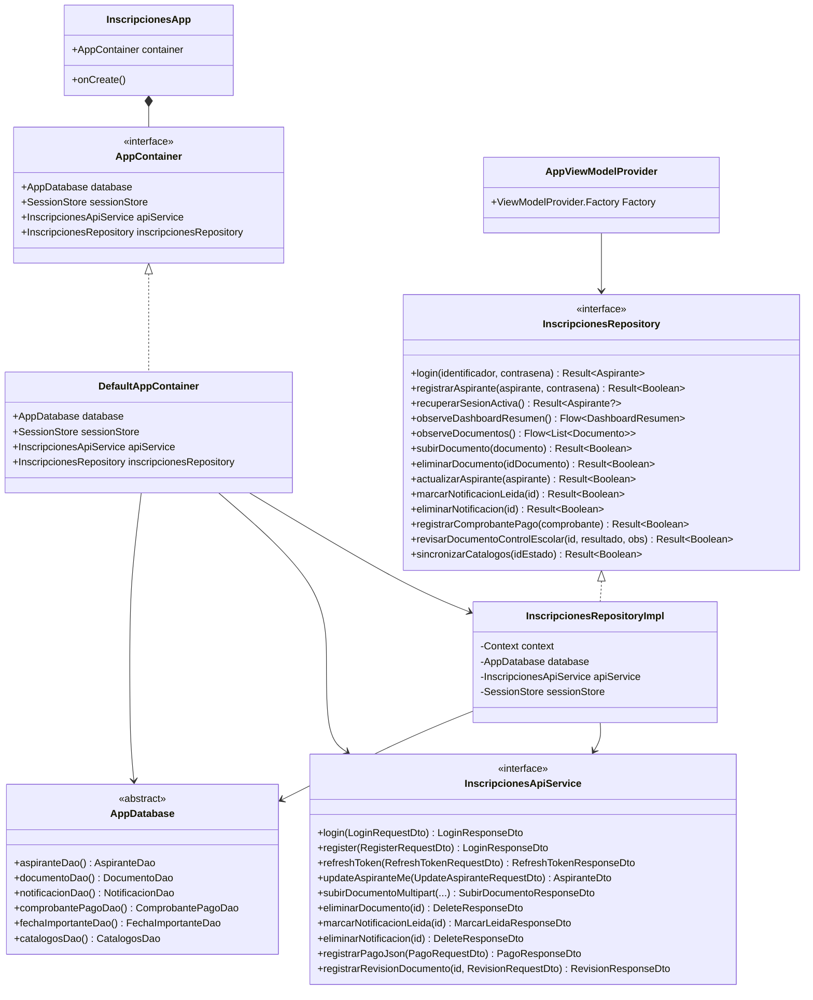

# B) Diagrama UML de Paquetes (`com.example.proyecto_appmovil`)

**Proyecto:** Sistema de Inscripciones ITSUR (Nuevo Ingreso)  
**Patrón Arquitectónico:** Clean Layered MVVM + Offline-First Repository + Manual Dependency Injection (`AppContainer`)

---

## 1. Diagrama Jerárquico de Paquetes y Clases Principales

```mermaid
flowchart TB
    subgraph ROOT["com.example.proyecto_appmovil"]
        APP_CLS["InscripcionesApp : Application"]
        MAIN_ACT["MainActivity : ComponentActivity"]

        subgraph PKG_DI["di (Inyección de Dependencias)"]
            DI_INT["«interface» AppContainer"]
            DI_IMPL["DefaultAppContainer(context)"]
        end

        subgraph PKG_NAV["navigation (Enrutamiento)"]
            NAV_HOST["AppNavHost(navController)"]
            NAV_SCREEN["«sealed» Screen\n(Login, Register, Home, Documents,\nStatus, Profile, Notifications,\nCredentialPhoto, Payment, AdminHome)"]
        end

        subgraph PKG_UI["ui (Capa de Presentación Jetpack Compose)"]
            VM_PROVIDER["AppViewModelProvider.Factory"]

            subgraph PKG_SCREENS["ui.screens"]
                SCR_AUTH["auth\n• LoginScreen / LoginViewModel\n• RegisterScreen / RegisterViewModel"]
                SCR_HOME["home\n• HomeScreen / HomeViewModel"]
                SCR_DOCS["documents\n• DocumentsScreen / DocumentsViewModel"]
                SCR_STATUS["status\n• StatusScreen / StatusViewModel"]
                SCR_PROFILE["profile\n• ProfileScreen / ProfileViewModel"]
                SCR_NOTIF["notifications\n• NotificationsScreen / NotificationsViewModel"]
                SCR_PHOTO["photo\n• CredentialPhotoScreen / CredentialPhotoViewModel"]
                SCR_PAYMENT["payment\n• PaymentScreen / PaymentViewModel"]
                SCR_ADMIN["admin\n• AdminHomeScreen / AdminHomeViewModel"]
            end

            subgraph PKG_COMP["ui.components (Widgets Institucionales)"]
                COMP_LIST["• ItsurTopBar\n• ItsurTextField\n• PrimaryButton\n• OptionCard\n• StatusChip\n• ErrorBanner"]
            end

            subgraph PKG_THEME["ui.theme (Sistema de Diseño)"]
                THEME_LIST["• Color.kt (Ciruela #874B6D, Rosa #FFD9EA)\n• Theme.kt (Proyecto_AppMovilTheme)\n• Type.kt (Typography Material 3)"]
            end
        end

        subgraph PKG_REPO["data.repository (Orquestación Single Source of Truth)"]
            REPO_INT["«interface» InscripcionesRepository"]
            REPO_IMPL["InscripcionesRepositoryImpl"]
        end

        subgraph PKG_LOCAL["data.local (Persistencia SQLite-Room y DataStore)"]
            ROOM_DB["«@Database» AppDatabase : RoomDatabase\n+ RoomConverters"]
            SESSION_STORE["SessionStore (DataStore Preferences)"]
            subgraph PKG_DAO["data.local.dao"]
                DAO_LIST["• AspiranteDao\n• DocumentoDao\n• ComprobantePagoDao\n• NotificacionDao\n• FechaImportanteDao\n• CatalogosDao"]
            end
            subgraph PKG_ENTITY["data.local.entity"]
                ENT_LIST["• UsuarioEntity\n• AspiranteEntity\n• DocumentoEntity\n• ComprobantePagoEntity\n• NotificacionEntity\n• FechaImportanteEntity\n• CarreraEntity / EstadoEntity / MunicipioEntity\n• FirmaReglamentoEntity"]
            end
        end

        subgraph PKG_REMOTE["data.remote (Cliente HTTP REST Retrofit 2)"]
            RETROFIT_CLIENT["RetrofitClient\n+ AuthInterceptor\n+ FallbackMockServerInterceptor"]
            subgraph PKG_API["data.remote.api"]
                API_SERVICE["«interface» InscripcionesApiService"]
            end
            subgraph PKG_DTO["data.remote.dto"]
                DTO_LIST["• AuthDto (Login/Register/Refresh/Resumen)\n• DocumentoDto (Subir/Revision/Delete)\n• NotificacionDto / FechaImportanteDto\n• PagoDto\n• CatalogoDto"]
            end
        end

        subgraph PKG_MODEL["model (Dominio y Reglas)"]
            MODEL_LIST["• Aspirante / DashboardResumen\n• EstadoInscripcion\n• Documento / TipoDocumento / EstadoDocumento\n• Notificacion / FechaImportante\n• ComprobantePago\n• CarreraCatalogo / EstadoCatalogo / MunicipioCatalogo"]
        end

        subgraph PKG_UTIL["util (Validación y Criptografía)"]
            UTIL_HASH["FileHashHelper (Copia interna + SHA-256)"]
        end
    end

    APP_CLS --> PKG_DI
    MAIN_ACT --> PKG_NAV
    MAIN_ACT --> PKG_THEME
    PKG_NAV --> PKG_SCREENS
    PKG_SCREENS --> PKG_COMP
    PKG_SCREENS --> VM_PROVIDER
    VM_PROVIDER --> PKG_DI
    PKG_SCREENS --> REPO_INT
    PKG_DI --> REPO_IMPL
    REPO_IMPL -.->|implementa| REPO_INT
    REPO_IMPL --> PKG_LOCAL
    REPO_IMPL --> PKG_REMOTE
    REPO_IMPL --> PKG_UTIL
    REPO_INT --> PKG_MODEL
    ROOM_DB --> PKG_DAO
    PKG_DAO --> PKG_ENTITY
    RETROFIT_CLIENT --> PKG_API
    PKG_API --> PKG_DTO
```

---

## 2. Diagrama de Clases y Relaciones entre Paquetes (`classDiagram`)

