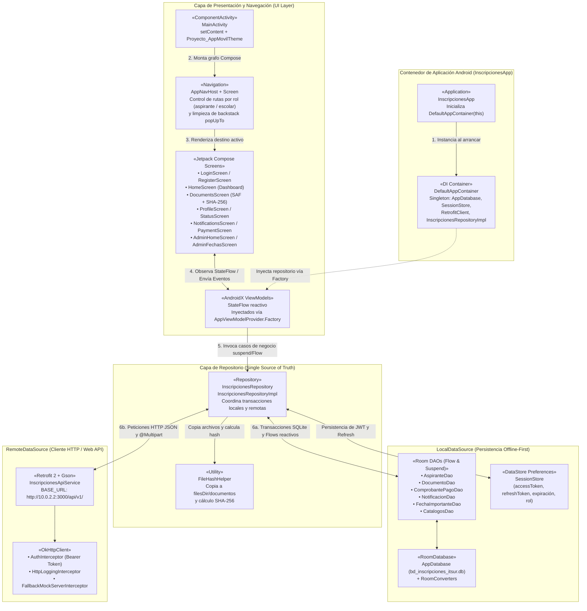
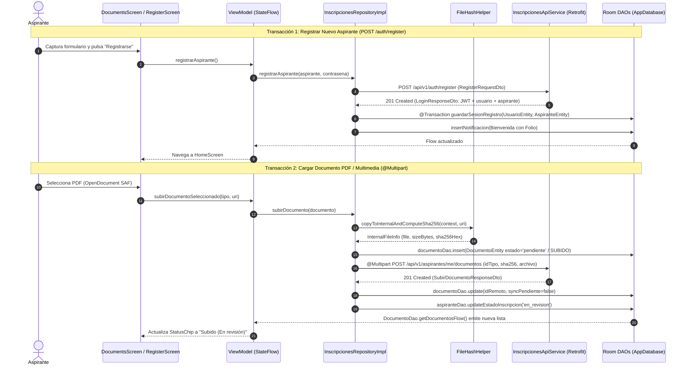
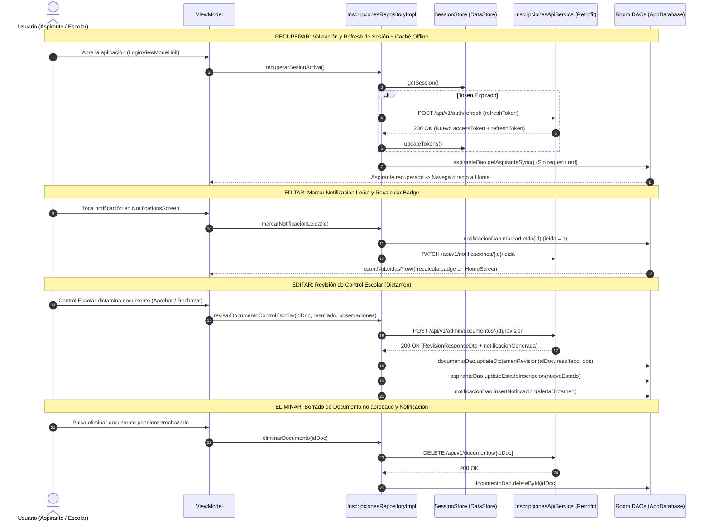

# C) Diagrama UML de Componentes y Cadena de Dependencias

**Proyecto:** Sistema de Inscripciones ITSUR (Nuevo Ingreso)  
**Flujo Arquitectónico Obligatorio:**  
`Application (InscripcionesApp) -> Activity (MainActivity) -> Navigation (AppNavHost) -> Compose Screens -> ViewModels (StateFlow) -> Repository (InscripcionesRepository) -> [LocalDataSource (Room AppDatabase / DAOs) | RemoteDataSource (Retrofit ApiService / OkHttp)]`

---

## 1. Diagrama UML de Componentes y Flujo Reactivo Unidireccional (UDF)

---

## 2. Diagramas de Secuencia de las Transacciones CRUD Implementadas

### 2.1 AGREGAR (Create): Registro de Aspirante y Carga de Documento con SHA-256

### 2.2 EDITAR, ELIMINAR Y RECUPERAR (Update, Delete, Restore)

