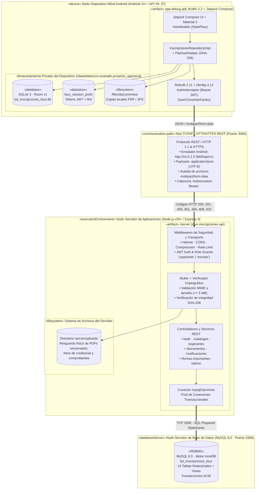

# D) Diagrama UML de Despliegue (Arquitectura Física y de Red)

**Proyecto:** Sistema de Inscripciones ITSUR (Nuevo Ingreso)  
**Entorno de Ejecución:** Cliente Móvil Android (API 29+) ⇄ Servidor Web API REST Node.js ⇄ MySQL 8 + Sistema de Archivos `/uploads`

---

## 1. Diagrama UML de Despliegue Completo

---

## 2. Especificación Técnica de Nodos y Protocolos de Comunicación

| Nodo / Artefacto | Tecnología / Especificación | Responsabilidad en la Arquitectura |
| :--- | :--- | :--- |
| **Nodo Dispositivo Android** | Android SDK 29–37, Kotlin 2.2, Jetpack Compose, Coroutines & `StateFlow` | Ejecución nativa de las 10 pantallas del sistema, captura multimedia con SAF/Cámara, cálculo local de hash `SHA-256` y operación *offline-first*. |
| **Base de Datos Local (Room)** | SQLite 3 (`bd_inscripciones_itsur.db`), 10 entidades Room y 6 DAOs reactivos | Persistencia local de sesión (`UsuarioEntity`, `AspiranteEntity`), documentos (`DocumentoEntity`), pagos (`ComprobantePagoEntity`), notificaciones (`NotificacionEntity`), fechas y catálogos (`CarreraEntity`, `EstadoEntity`, `MunicipioEntity`). |
| **Canal de Comunicación** | HTTP/HTTPS REST (`http://10.0.2.2:3000/api/v1/` en emulador) | Transporte de payloads `application/json` y archivos binarios `multipart/form-data` autenticados con `Authorization: Bearer <accessToken>`. |
| **Nodo Servidor Web API** | Node.js + Express (`server/src/app.js`), Multer, Helmet, CORS, Crypto | Exposición del contrato REST `/api/v1/*`, validación de integridad SHA-256, cálculo automático de estado de inscripción y emisión de notificaciones. |
| **Sistema de Archivos (`/uploads`)** | Almacenamiento en disco (`server/uploads/`) | Resguardo seguro de los archivos PDF de documentos obligatorios, fotografías de credencial y comprobantes bancarios fuera de la raíz pública. |
| **Nodo Base de Datos Relacional** | MySQL 8.0 (`InnoDB`, `utf8mb4`), esquema `server/database/schema.sql` | Almacenamiento relacional centralizado con integridad referencial (`FOREIGN KEY`), restricciones de dominio (`ENUM`, `CHECK`, `UNIQUE`) y control de versiones de documentos. |
